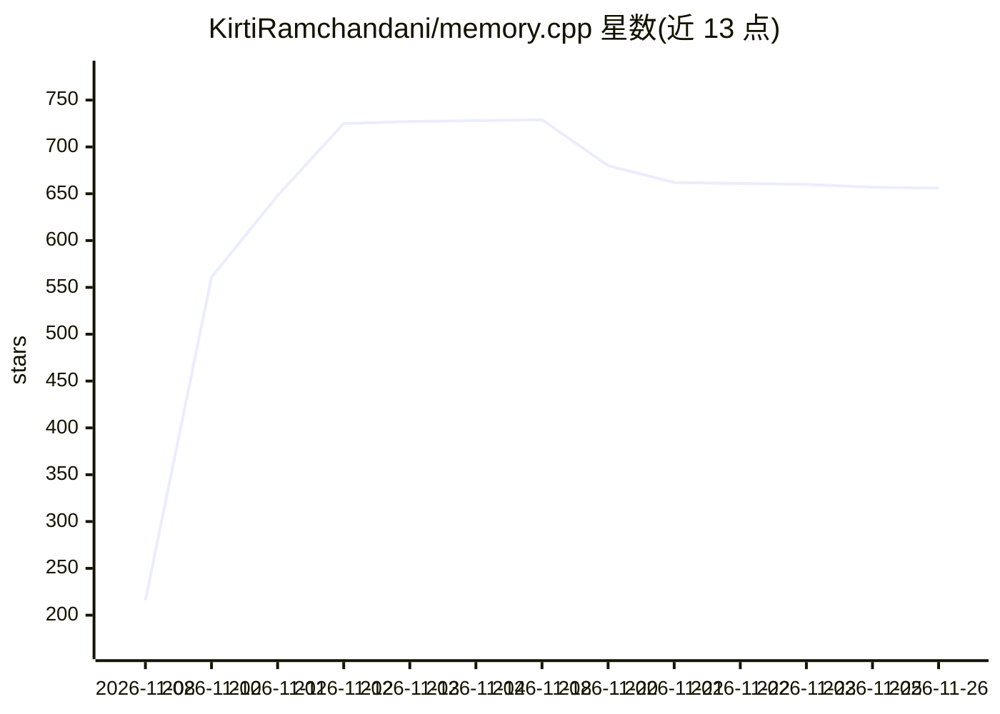

# KirtiRamchandani/memory.cpp

⭐ 656 · Rust · MIT · 推送 2026-11-02 · [GitHub](https://github.com/KirtiRamchandani/memory.cpp) · [官网](https://github.com/KirtiRamchandani/memory.cpp) · 个人维护

**给编码代理的本地优先上下文编译器：生成可缓存的提示包**

面向开发者与编码代理的本地优先 pre-inference 上下文编译工具：把仓库历史（决策、修复、测试、规则、先前 agent 工作）编译为带新鲜度证明、安全过滤、字节稳定前缀的上下文包。机制包括 MemoryIR、稳定前缀+新鲜后缀分离、负向记忆、KV 感知优化、rehydratable handle 与可复现 ledger/lockfile；提供大量 CLI 子命令、MCP 接入与面向 Claude/Codex/Gemini/Cursor 等的 provider pack。附自带消融基准 CAMC-Bench。Rust 实现，cargo 构建，数据存于本地 SQLite，默认无网络调用。

## 筛选速览

| 维度 | 判定 | 备注 |
|---|---|---|
| AI 角色 | `ai-ecosystem` | LLM/agent 周边工具 |
| 许可风险 | `permissive` | MIT |
| 部署形态 | `library` | 以包/库形式分发 |
| 模型依赖 | — | README 未给出锁定关系 |
| 硬件要求 | — | 无带数字的原话,不猜 |
| 安装摩擦 | `low` | 无编译、无系统依赖或容器化 |
| 成熟度 | — | 结构信号不足 |

## 能力要点

- MemoryIR + 稳定前缀/新鲜后缀编译，blake3 哈希字节稳定前缀
- 负向记忆与新鲜度证明阻止过期/矛盾/敏感内容进入提示
- CAMC-Bench 消融基准与 dogfooding 数据（854 vs 7,961 tokens）
- write firewall、密钥脱敏、注入隔离与只读 MCP 默认策略

## 适用场景

- 为编码代理生成更小且可复用的提示上下文，减少 token 消耗
- 阻止过期文档与旧失败尝试泄漏进上下文导致错误补丁
- 审计与复现 agent 每次实际发送的上下文内容
- 本地优先、无遥测地管理跨会话仓库记忆

## 场景标签

`Agent 记忆` · 领域:Agent 开发

## 证据(README 行号)

> L7: `memory.cpp` is a **local-first, pre-inference context compiler**. It turns repository
> L149: Most memory systems optimize **storage and retrieval**. memory.cpp focuses on what

## 星数曲线

2026-11-08 216 → 2026-11-26 656（+440）

---
*卡片 v1 · prompt 1.4 · 生成 2026-11-17 · 置信度 high · 依据 README sha `7cd9e709d673` · [字段定义](../../DATASET.md)*
