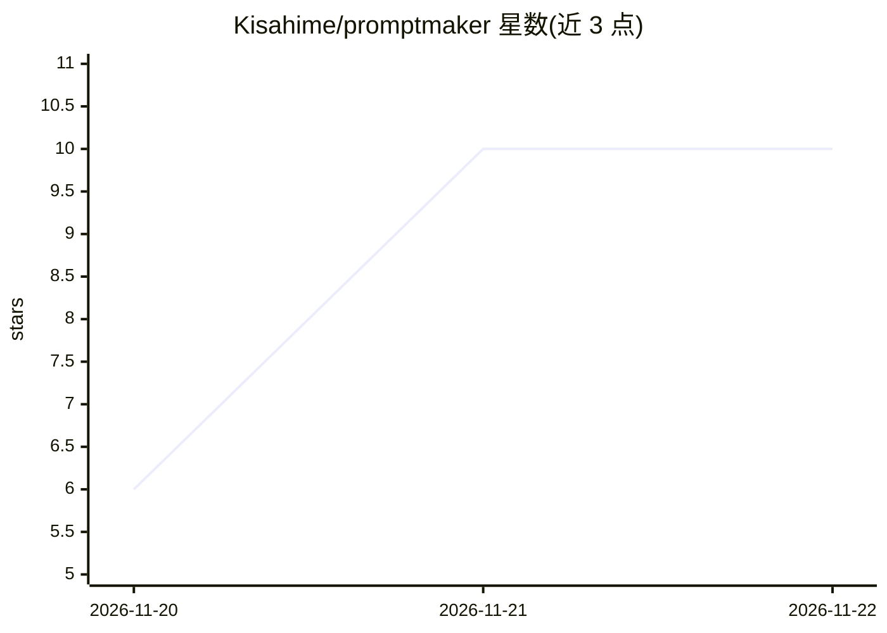

# Kisahime/promptmaker

⭐ 10 · Python · MIT · 推送 2026-11-18 · [GitHub](https://github.com/Kisahime/promptmaker) · 个人维护

**本地桌面工作室：把想法整理成面向图像/视频模型的提示词**

PromptMaker 是一个运行在本地的桌面应用：用户用自然语言描述想法，从约 800 个预设中构建提示词，与本地 LLM 对话打磨，或按清晰度、构图、风格等维度打分，并为 FLUX、SDXL、Pony、Illustrious 等目标模型格式化输出。它还支持把提示词直接发送到 Forge/AUTOMATIC1111 或 ComfyUI 生成图像，包含 Face Swap、壁纸模式、角色、分镜与漫画、视频生成（Wan2GP）、LoRA 训练等功能。AI 功能为可选项，通过 Ollama、LM Studio、llama.cpp 等本地后端或云端提供，默认一切在本机运行且不擅自下载内容。

## 筛选速览

| 维度 | 判定 | 备注 |
|---|---|---|
| AI 角色 | `ai-native` | 本体是模型或模型工具 |
| 许可风险 | `permissive` | MIT |
| 部署形态 | `desktop` | 安装包/桌面程序 |
| 模型依赖 | local-ok | 支持本地模型 |
| 硬件要求 | `gpu-8g` | |
| 安装摩擦 | `medium` | 含编译或系统依赖之一 |
| 成熟度 | — | 结构信号不足 |

## 能力要点

- 800 个预设的分类构建器与模型感知的实时预览
- 对接 Forge/AUTOMATIC1111 与 ComfyUI 生成图像，带自动生成-检查-精修循环
- Video maker 将故事转化为 Wan2GP 剪辑并输出 MP4，全流程本地
- AI 后端可选 Ollama、LM Studio、llama.cpp、KoboldCpp、vLLM 及 OpenAI 兼容服务

## 适用场景

- 为 FLUX、SDXL 等模型快速写出格式合规的提示词
- 在本地通过 Forge/ComfyUI 生成并迭代图像与壁纸
- 用分镜与角色功能制作保持人物一致性的漫画与短视频
- 用图生文功能把已有图片反推为可编辑提示词

## 场景标签

`提示工程` `图像生成` `视频生成` · 领域:Agent 开发

## 证据(README 行号)

> L5: **A local desktop studio for writing AI image prompts.** You can describe an idea in plain words, build a prompt fro
> L7: Everything runs on your own computer by default, and nothing is downloaded without asking. The AI features are optio
> L15: - **Runs on modest hardware**: built and tested on an 8 GB GPU.

## 星数曲线

2026-11-20 6 → 2026-11-22 10（+4）

---
*卡片 v1 · prompt 1.4 · 生成 2026-11-20 · 置信度 mid · 依据 README sha `6217d2166391` · [字段定义](../../DATASET.md)*
