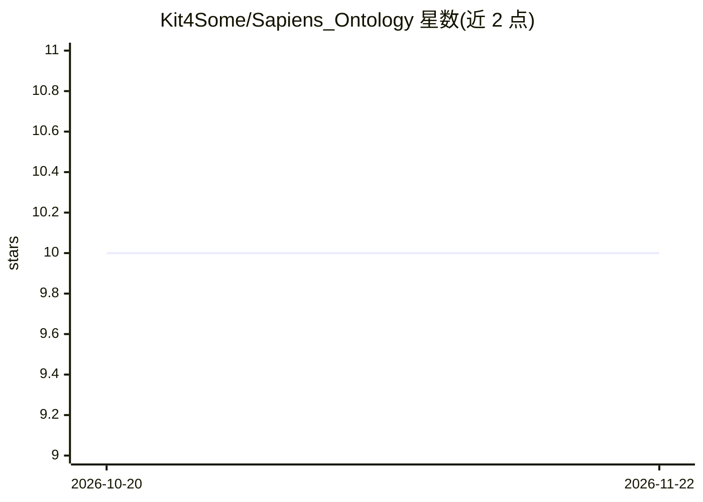

# Kit4Some/Sapiens_Ontology

⭐ 10 · Python · Apache-2.0 · 推送 2026-04-12 · [GitHub](https://github.com/Kit4Some/Sapiens_Ontology) · [官网](https://sapiens.team) · 组织维护

**基于知识图谱的本体推理问答系统（ToG 3.0 + MACER）**

一个知识图谱推理引擎，实现 Think-on-Graph 3.0 与 MACER 框架，按 Constructor→Retriever→Reflector→Responser 四阶段流水线对结构化知识图谱进行探索、验证与证据综合，支持向量检索、图遍历、社区摘要、Text2Cypher 与混合五种证据策略，并带五维证据评分与矛盾检测。面向需要多跳推理与可追溯证据的开发者/团队，通过 FastAPI 提供查询与摄取接口，支持 Docker、手动安装及 Electron 桌面端。需配合 Neo4j 图数据库与 LLM 服务使用。

## 筛选速览

| 维度 | 判定 | 备注 |
|---|---|---|
| AI 角色 | `ai-native` | 本体是模型或模型工具 |
| 许可风险 | `permissive` | Apache-2.0 |
| 部署形态 | `library` | 以包/库形式分发 |
| 模型依赖 | local-ok | 支持本地模型 |
| 硬件要求 | — | 无带数字的原话,不猜 |
| 安装摩擦 | `low` | 无编译、无系统依赖或容器化 |
| 成熟度 | — | 结构信号不足 |

## 能力要点

- MACER 四阶段元认知推理流水线（Retriever 带循环）
- 五种证据收集策略与五维加权证据评分、矛盾检测
- Text2Cypher 自然语言转 Cypher 并具自愈能力
- SDDI 摄取管线支持 JSON/PDF/MD/CSV 等多格式文档入库

## 适用场景

- 对企业知识库做多跳问题推理与证据溯源
- 将多格式文档摄取为知识图谱并支持增量更新
- 搭建需要置信度分级与失败透明说明的问答服务
- 用自然语言生成 Cypher 查询图数据库

## 场景标签

`知识图谱` · 领域:知识与检索

## 证据(README 行号)

> L20: Ontology Reasoning System is a next-generation knowledge graph reasoning engine that goes far beyond traditional RA
> L38: │ Constructor │ -> │  Retriever  │ -> │  Reflector  │ -> │  Responser  │
> L59: - **LLM Failover**: Automatic cascade (OpenAI → Anthropic → Azure → Ollama)

## 星数曲线

2026-10-20 10 → 2026-11-22 10（+0）

---
*卡片 v1 · prompt 1.4 · 生成 2026-11-20 · 置信度 mid · 依据 README sha `df4548ea0f2b` · [字段定义](../../DATASET.md)*
