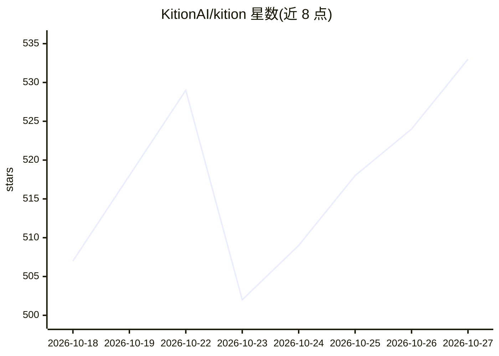

# KitionAI/kition

⭐ 533 · TypeScript · Apache-2.0 · 推送 2026-10-26 · [GitHub](https://github.com/KitionAI/kition) · [官网](https://kition.ai) · 组织维护 · 中文 README

**本地优先桌面工作区：文档/表格/白板/AI Agent/自动化**

基于 Tauri 2 (Rust) + React 的开源桌面应用（Apache 2.0，beta 阶段），把 Markdown 文档、结构化表格文件、无限画布白板、可用工具的 AI Agent、联网研究与可视化工作流整合在一个本地工作区。Agent 可读写活动文档与表格记录，其编辑以 diff 形式呈现供逐条接受/拒绝；表格提供 AI 字段（文本/结构化值/媒体生成、票据 OCR 提取）。支持触发-动作工作流、邮件连接与 MCP/代理等设置。GitHub Releases 提供 macOS/Windows 安装包与 Linux AppImage；Kition 运行时源码不包含在本仓库。

## 筛选速览

| 维度 | 判定 | 备注 |
|---|---|---|
| AI 角色 | `ai-enhanced` | 去掉 AI 部分产品仍成立 |
| 许可风险 | `permissive` | Apache-2.0 |
| 部署形态 | `desktop` | 安装包/桌面程序 |
| 模型依赖 | — | README 未给出锁定关系 |
| 硬件要求 | — | 无带数字的原话,不猜 |
| 安装摩擦 | `low` | 无编译、无系统依赖或容器化 |
| 成熟度 | `idea` | |

## 能力要点

- AI Agent 可编辑文档与表格，改动以 diff 呈现供逐条接受/拒绝
- AI 表格字段：文本/结构化值/媒体生成，票据图片 OCR 提取为记录
- 可视化触发-动作工作流（模板、单步测试、运行历史）
- Markdown 文档、结构化表格与无限白板同处一个工作区

## 适用场景

- 在一个本地应用里写文档、管数据、画流程图并让 AI 协助
- 批量生成营销素材并把 AI 产出作为可审查的记录管理
- 把重复工作编排为可测试的自动化工作流

## 场景标签

`知识库管理` `工作流自动化` `AI 助手` · 领域:效率与自动化

## 证据(README 行号)

> L35: Kition brings Markdown documents, structured table files, an infinite
> L36: Whiteboard, a tool-using AI agent, web research, and visual workflows into
> L55: - **An Agent that can act.** Search the web, inspect documents and
> L64: Instead of returning another suggestion to copy and paste, the Kition Agent can

## 星数曲线

2026-10-18 507 → 2026-10-27 533（+26）

---
*卡片 v1 · prompt 1.4 · 生成 2026-10-21 · 置信度 mid · 依据 README sha `8d130675edfb` · [字段定义](../../DATASET.md)*
