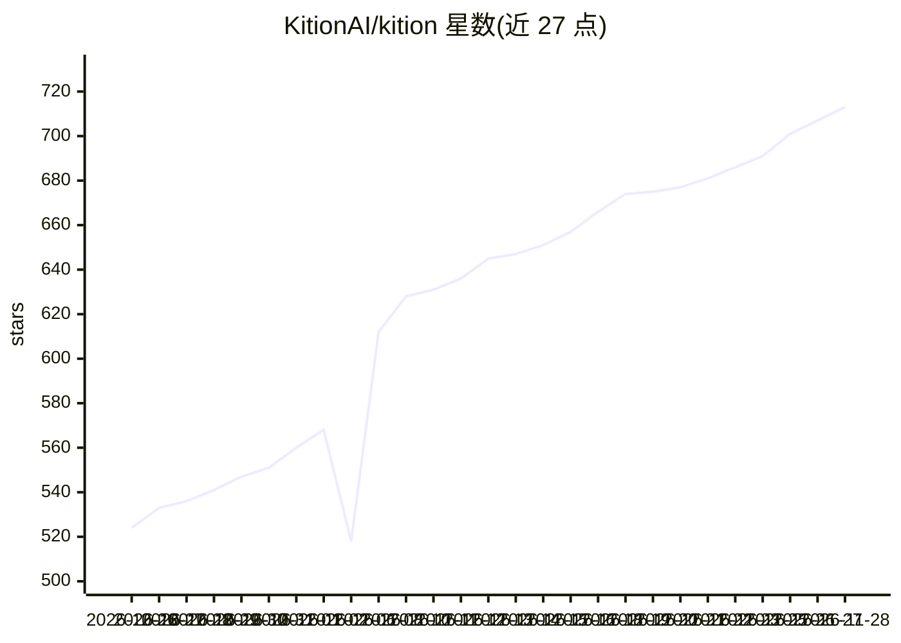

# KitionAI/kition

⭐ 713 · Rust · Apache-2.0 · 推送 2026-11-26 · [GitHub](https://github.com/KitionAI/kition) · [官网](https://kition.ai) · 组织维护 · 中文 README

**AI agent 可共同编辑文件的桌面创作办公套件**

Kition 是一个桌面工作区，每个文件由对应的 kit 编辑器打开：覆盖视频、动效、分层图像、幻灯片、表格、Word/PDF 文档、笔记、白板、CAD、3D 场景等 16 种文件类型，kit 引擎以 Rust 编译为 WebAssembly 在 Web Worker 中运行。AI agent 通过 Kit Harness Protocol 驱动同一引擎，用与用户相同的命令读写文件、预览结果并在草稿中工作，可被人工审核后才落盘。可通过 npm 安装的 CLI 将 kits 以 MCP 服务器形式接入 agent 客户端。当前版本 0.1.1 处于 beta，桌面安装包尚未发布，需从源码运行。

## 筛选速览

| 维度 | 判定 | 备注 |
|---|---|---|
| AI 角色 | `ai-enhanced` | 去掉 AI 部分产品仍成立 |
| 许可风险 | `permissive` | Apache-2.0 |
| 部署形态 | `library` | 以包/库形式分发 |
| 模型依赖 | — | README 未给出锁定关系 |
| 硬件要求 | — | 无带数字的原话,不猜 |
| 安装摩擦 | `low` | 无编译、无系统依赖或容器化 |
| 成熟度 | `idea` | |

## 能力要点

- 16 种文件类型各配一个开源 kit 编辑器（Rust→WebAssembly）
- agent 经 kit 对象模型编辑文件、预览与运行检查，草稿冲突写入会被拒绝
- kition CLI 以 MCP 服务器形式供 Claude Code/Codex/Cursor 等客户端使用
- 本地运行时仅监听 loopback HTTP API

## 适用场景

- 在桌面端一站式编辑视频、表格、文档、设计稿等多类文件
- 让 agent 直接修改工作区里的文件并人工审核草稿
- 通过表格的 AI 字段对每行批量提取、生成和摘要

## 场景标签

`知识库管理` · 领域:知识与检索

## 证据(README 行号)

> L35: Kition is a desktop workspace where every file opens in a real editor, and an AI agent works on
> L62: A kit is the editor for one kind of file. Its engine is written in Rust, compiled to WebAssembly
> L111: Desktop builds of Kition 0.1.1 for macOS, Windows and Linux will be published on

## 星数曲线

2026-10-26 524 → 2026-11-28 713（+189）

---
*卡片 v1 · prompt 1.4 · 生成 2026-11-24 · 置信度 high · 依据 README sha `cb78222d032d` · [字段定义](../../DATASET.md)*
