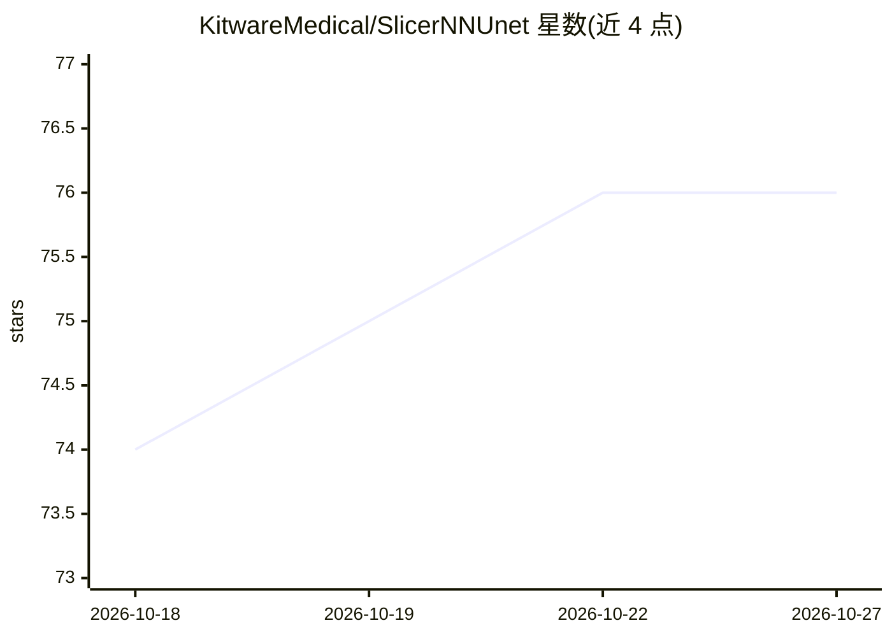

# KitwareMedical/SlicerNNUnet

⭐ 76 · Python · BSD-3-Clause · 推送 2026-10-25 · [GitHub](https://github.com/KitwareMedical/SlicerNNUnet) · 组织维护

**3D Slicer 扩展：仅凭训练文件夹即可运行 nnUNet 模型做医学图像分割**

面向 3D Slicer 用户的扩展模块：在 Slicer 环境内安装 nnUNet 依赖、加载训练好的模型文件夹，对输入体积数据执行推理并把带标签的分割结果载入 Segment Editor 查看/编辑。支持多通道输入模型的多个体积选择器；要求模型权重保留 nnUNet 规定的目录结构（dataset_id/训练器配置/fold/checkpoint_final.pth/dataset.json），否则推理报错。提供 Parameter.isValid 方法校验模型结构；修改推理参数需修改 Parameter 类。安装方式为 Slicer 扩展管理器，首次安装后可能需重启 Slicer。

## 筛选速览

| 维度 | 判定 | 备注 |
|---|---|---|
| AI 角色 | `ai-native` | 本体是模型或模型工具 |
| 许可风险 | `permissive` | BSD-3-Clause |
| 部署形态 | `None` |  |
| 模型依赖 | — | README 未给出锁定关系 |
| 硬件要求 | — | 无带数字的原话,不猜 |
| 安装摩擦 | `low` | 无编译、无系统依赖或容器化 |
| 成熟度 | — | 结构信号不足 |

## 能力要点

- 仅凭 nnUNet 训练文件夹即可在 3D Slicer 内安装并运行模型
- 推理结果带标签载入 Segment Editor 查看与编辑
- 支持多通道输入模型，按期望顺序提供多个体积选择器
- Parameter.isValid 方法校验模型目录结构合法性

## 适用场景

- 在 3D Slicer 中直接用已训练的 nnUNet 模型做医学图像分割
- 测试 Total Segmentator 权重（配合 CTChest 示例数据）
- 开发与集成新的 nnUNet 模型到 3D Slicer 环境

## 场景标签

`目标检测` · 领域:感知与多模态

## 证据(README 行号)

> L7: This module allows to install and run nnUNet trained models in 3D Slicer with only the training folder.
> L52: Once the model has finished running, the segmentation will be loaded into 3D Slicer with its associated labels.

## 星数曲线

2026-10-18 74 → 2026-10-27 76（+2）

---
*卡片 v1 · prompt 1.4 · 生成 2026-10-24 · 置信度 high · 依据 README sha `2a6225536afc` · [字段定义](../../DATASET.md)*
