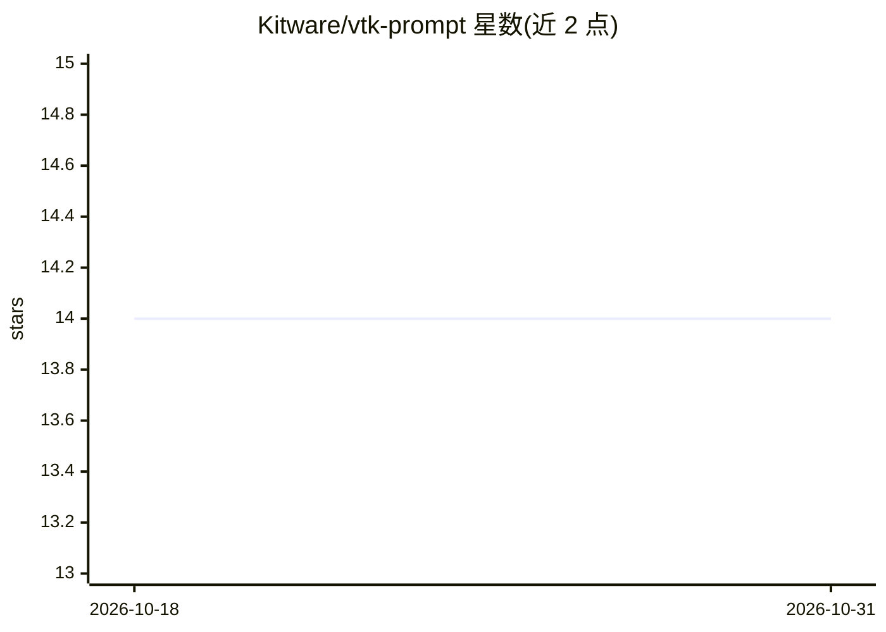

# Kitware/vtk-prompt

⭐ 14 · Python · MIT · 推送 2026-10-29 · [GitHub](https://github.com/Kitware/vtk-prompt) · 组织维护

**用自然语言生成 VTK 可视化代码的 CLI 与 Web UI 工具**

面向科学可视化开发者与科研用户：输入自然语言描述，通过 LLM（Anthropic Claude、OpenAI、Gemini、NVIDIA NIM 及本地模型）生成并执行 VTK 可视化代码，实时渲染结果。提供 CLI、Python API 和基于 Trame 的交互式 Web UI；可选接入 vtk-mcp MCP 服务器，为 LLM 提供 VTK 示例语义搜索、类 API 查询与代码校验。支持 Docker Compose 部署（含多用户 Google 登录模式），并跟踪 token 用量与成本。

## 筛选速览

| 维度 | 判定 | 备注 |
|---|---|---|
| AI 角色 | `ai-native` | 本体是模型或模型工具 |
| 许可风险 | `permissive` | MIT |
| 部署形态 | `self-host` | docker 或自建部署 |
| 模型依赖 | local-ok | 支持本地模型 |
| 硬件要求 | — | 无带数字的原话,不猜 |
| 安装摩擦 | `low` | 无编译、无系统依赖或容器化 |
| 成熟度 | — | 结构信号不足 |

## 能力要点

- 多 LLM 提供商接入：Anthropic/OpenAI/Gemini/NVIDIA NIM/本地模型
- Trame Web UI 实时渲染生成的 VTK 可视化
- vtk-mcp 集成提供语义搜索、类 API 查询与代码校验
- Docker Compose 部署，支持 Google 登录多用户隔离

## 适用场景

- 用自然语言快速生成 VTK 科学可视化代码
- 在 Web UI 中迭代调参并实时预览可视化结果
- 团队部署多用户可视化代码生成服务

## 场景标签

`代码生成` · 领域:编码与开发

## 证据(README 行号)

> L9: A command-line interface and web-based UI for generating VTK visualization code
> L17: - Multiple LLM providers: Anthropic Claude, OpenAI GPT, NVIDIA NIM, and local
> L330: - **UI**: Trame-based web interface with VTK rendering

## 星数曲线

2026-10-18 14 → 2026-10-31 14（+0）

---
*卡片 v1 · prompt 1.4 · 生成 2026-10-31 · 置信度 high · 依据 README sha `a48d065deabe` · [字段定义](../../DATASET.md)*
