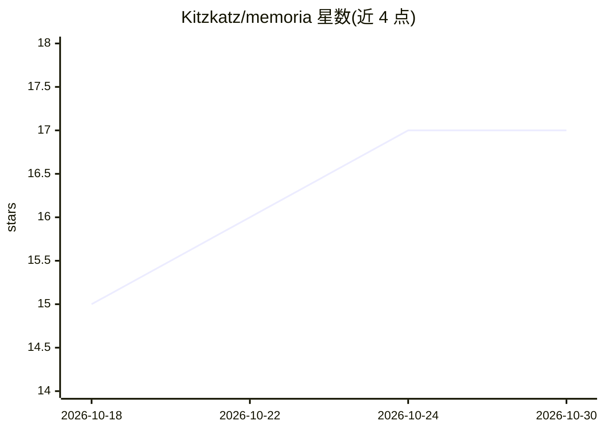

# Kitzkatz/memoria

⭐ 17 · Python · MIT · 推送 2026-10-08 · [GitHub](https://github.com/Kitzkatz/memoria) · 个人维护

**本地优先、LLM 无关的记忆基础设施，混合检索与多信号排序**

面向 LLM agent 与本地应用的记忆系统：以 FAISS 向量、BM25、图、短语、属性、时序六路并行检索加多信号融合排序，采用黑板调度模型协调 worker，存储与检索实现解耦。核心功能无需 LLM、API key、云服务或 GPU，可在 CPU 与约 4GB 内存环境运行。提供 Python API、CLI、TUI、GUI、HTTP API 与 MCP 服务器，支持 Obsidian 库摄取适配器与配置驱动的插件体系，另含 LongMemEval 等评测基础设施。

## 筛选速览

| 维度 | 判定 | 备注 |
|---|---|---|
| AI 角色 | `ai-ecosystem` | LLM/agent 周边工具 |
| 许可风险 | `permissive` | MIT |
| 部署形态 | `library` | 以包/库形式分发 |
| 模型依赖 | — | README 未给出锁定关系 |
| 硬件要求 | `cpu-ok` | |
| 安装摩擦 | `low` | 无编译、无系统依赖或容器化 |
| 成熟度 | — | 结构信号不足 |

## 能力要点

- 向量/BM25/图/短语/属性/时序六路并行检索与多信号融合排序
- 核心功能无需 LLM、API key、云服务与 GPU（CPU-only，约 4GB 内存可运行）
- 内置 MCP 服务器，MCP 兼容客户端可将 Memoria 作为外部记忆系统
- Obsidian vault 摄取适配器与配置驱动的插件体系（含插件生成器）

## 适用场景

- 为 LLM agent 或 MCP 客户端挂载本地长期记忆
- 将 Obsidian 笔记库导入并做多信号混合检索
- 在低配 CPU 机器上本地运行记忆与检索服务

## 场景标签

`Agent 记忆` · 领域:Agent 开发

## 证据(README 行号)

> L3: **Local-first, LLM-agnostic memory infrastructure with parallel hybrid retrieval, multi-signal ranking, declarative 
> L22: Memoria is memory infrastructure first — built to store, retrieve, rank, route, and manage information independentl
> L146: Available operations: `memory_search`, `memory_store`, `memory_store_many`, `memory_fetch`, `memory_update`, `memo

## 星数曲线

2026-10-18 15 → 2026-10-30 17（+2）

---
*卡片 v1 · prompt 1.4 · 生成 2026-10-30 · 置信度 high · 依据 README sha `1cc0752fdf7e` · [字段定义](../../DATASET.md)*
