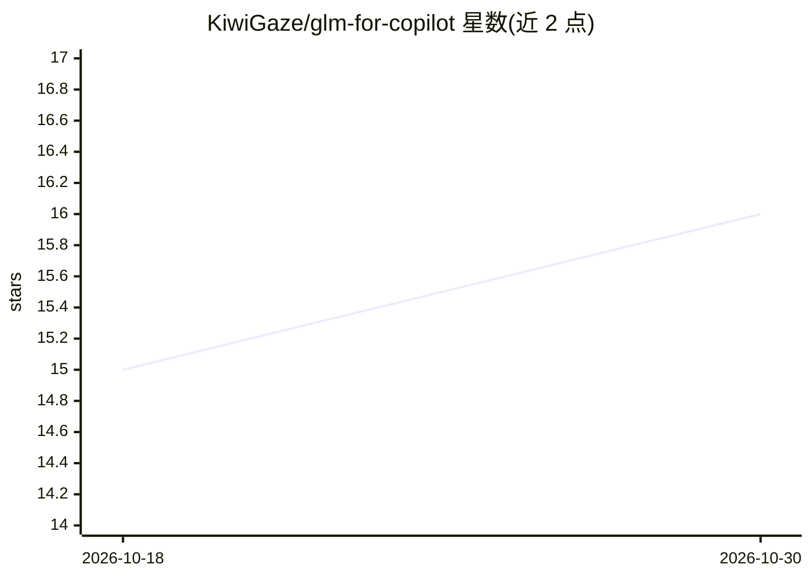

# KiwiGaze/glm-for-copilot

⭐ 16 · TypeScript · MIT · 推送 2026-10-26 · [GitHub](https://github.com/KiwiGaze/glm-for-copilot) · [官网](https://marketplace.visualstudio.com/items?itemName=yijiazhen-qi.glm-for-github-copilot-chat) · 个人维护 · 中文 README

**把 GLM 模型接入 GitHub Copilot Chat 的 BYOK VS Code 扩展**

非官方社区 VS Code 扩展，通过 Copilot 原生 Language Model Provider API 将智谱 GLM 系列（GLM-5.3、Flash、FlashX 及旧版）加入 Copilot Chat 模型选择器，用户自带 API key（BYOK），支持图像输入、工具调用、agent 模式与流式思考。支持 Coding Plan 订阅与按量 Standard API 两种模式，国际（z.ai）与国内（bigmodel.cn）端点可选，提供用量/余额面板，密钥存于 OS 钥匙串。要求 VS Code 1.127+、有效 Copilot 订阅与 GLM key；声明与智谱、GitHub、Microsoft 无隶属关系。

## 筛选速览

| 维度 | 判定 | 备注 |
|---|---|---|
| AI 角色 | `ai-ecosystem` | LLM/agent 周边工具 |
| 许可风险 | `permissive` | MIT |
| 部署形态 | `None` |  |
| 模型依赖 | — | README 未给出锁定关系 |
| 硬件要求 | — | 无带数字的原话,不猜 |
| 安装摩擦 | `low` | 无编译、无系统依赖或容器化 |
| 成熟度 | — | 结构信号不足 |

## 能力要点

- GLM 模型与 GPT/Claude 并列出现在 Copilot 原生选择器，agent 模式与工具调用保持可用
- Coding Plan 与 Standard API 双模式，国际/国内端点可选，支持 baseUrl 覆盖与自定义模型
- 状态栏与面板展示会话/周 token 配额、余额与重置倒计时
- 文本模型图像输入经 Flash 生成中性描述回填；密钥经 VS Code SecretStorage 存储

## 适用场景

- 用自己的 GLM key 在 Copilot Chat 里做日常编码与 agent 编程
- 订阅 GLM Coding Plan 后跟踪会话/周配额与余额
- 国内网络下经 bigmodel.cn 端点使用 GLM 模型

## 场景标签

`模型网关` · 领域:Agent 开发

## 证据(README 行号)

> L11: Bring Z.AI's GLM models into GitHub Copilot Chat with your own API key (BYOK) — **GLM-5.3**, the default 1M-context
> L20: - **Powers Copilot up, doesn't replace it.** GLM models appear alongside GPT and Claude. Because the extension uses

## 星数曲线

2026-10-18 15 → 2026-10-30 16（+1）

---
*卡片 v1 · prompt 1.4 · 生成 2026-10-30 · 置信度 high · 依据 README sha `7646542cc326` · [字段定义](../../DATASET.md)*
