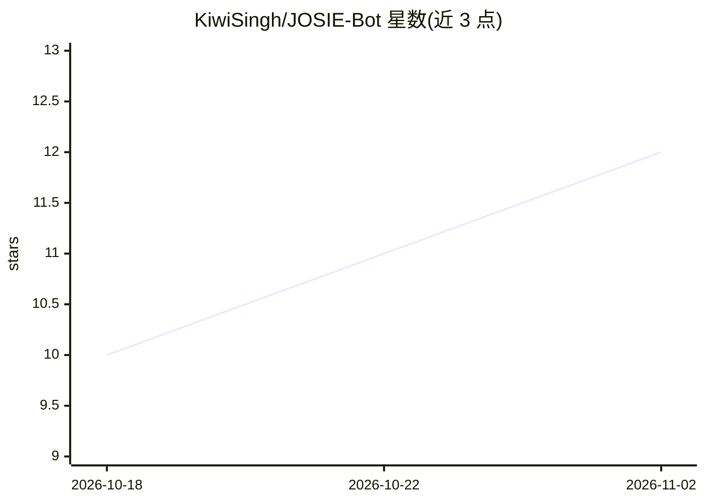

# KiwiSingh/JOSIE-Bot

⭐ 12 · Swift · MIT · 推送 2026-03-07 · [GitHub](https://github.com/KiwiSingh/JOSIE-Bot) · 个人维护

**本地离线 AI 角色扮演/情感陪伴桌面与移动应用**

面向终端用户的本地 AI 陪伴应用，主打角色扮演与情感对话。桌面端（Linux/macOS/Windows）以 Ollama 为推理后端，iOS 用 MLXLLM、Android 用 Llama.CPP；内置多款角色扮演模型可切换，集成语音交互（Edge TTS 语音合成、本地化 STT）。数据全部留在本机，不调用云端 API；会话内保持上下文记忆。提供各平台安装包，也可从 Python 源码运行并用 PyInstaller 打包。iOS/Android 版模型选择与桌面端不同，需手动导入或应用内下载。

## 筛选速览

| 维度 | 判定 | 备注 |
|---|---|---|
| AI 角色 | `ai-native` | 本体是模型或模型工具 |
| 许可风险 | `permissive` | MIT |
| 部署形态 | `desktop` | 安装包/桌面程序 |
| 模型依赖 | local-ok | 支持本地模型 |
| 硬件要求 | — | 无带数字的原话,不猜 |
| 安装摩擦 | `low` | 无编译、无系统依赖或容器化 |
| 成熟度 | — | 结构信号不足 |

## 能力要点

- 桌面端基于 Ollama 本地推理，无云端 API
- 多款角色扮演模型一键切换与内置安装按钮
- 集成语音交互：Edge TTS 合成 + 本地化 STT
- 覆盖 Linux/macOS/Windows/iOS/Android 五个平台

## 适用场景

- 在本地离线进行角色扮演与情感对话
- 用语音与 AI 陪伴角色实时交流
- 在手机上运行本地角色扮演模型且数据不出设备

## 场景标签

`聊天机器人` `语音合成` · 领域:对话与助手

## 证据(README 行号)

> L6: JOSIE is a premium, localized AI desktop application designed for immersive roleplay and emotional conversations. Po
> L16: - **🛡️ 100% Private & Local**: No cloud APIs, no data mining. Everything stays on your machine using the Ollama bac

## 星数曲线

2026-10-18 10 → 2026-11-02 12（+2）

---
*卡片 v1 · prompt 1.4 · 生成 2026-11-02 · 置信度 mid · 依据 README sha `056e5118ddbc` · [字段定义](../../DATASET.md)*
