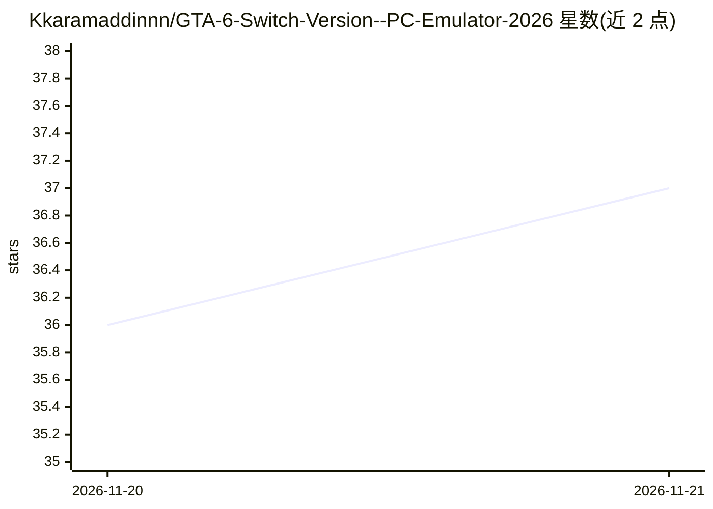

# Kkaramaddinnn/GTA-6-Switch-Version--PC-Emulator-2026

⭐ 37 · Rust · Apache-2.0 · 推送 2026-11-19 · [GitHub](https://github.com/Kkaramaddinnn/GTA-6-Switch-Version--PC-Emulator-2026) · 个人维护

**面向 Windows 玩家的 GTA VI PC 版安装准备与优化指南**

为等待 GTA VI PC 版发布的 Windows 玩家提供的安装与配置资源：覆盖 Windows 准备、GPU 驱动更新、存储检查、Rockstar Games Launcher 准备、图形/FPS 优化与常见故障排查。README 明确声明官方 PC 版发布日期与硬件要求尚未公布，配套安装器本身不包含或不安装游戏文件，游戏需从授权渠道另行获取。内容以指南与检查清单为主，多处标注待官方信息发布后更新。

## 筛选速览

| 维度 | 判定 | 备注 |
|---|---|---|
| AI 角色 | `ai-knowledge` | 知识聚合/清单类 |
| 许可风险 | `permissive` | Apache-2.0 |
| 部署形态 | `desktop` | 安装包/桌面程序 |
| 模型依赖 | — | README 未给出锁定关系 |
| 硬件要求 | — | 无带数字的原话,不猜 |
| 安装摩擦 | `low` | 无编译、无系统依赖或容器化 |
| 成熟度 | — | 结构信号不足 |

## 能力要点

- Windows 兼容性准备清单（系统版本/DirectX/驱动/存储检查）
- FPS 与卡顿问题的排查步骤（GPU 驱动、Game Mode、温控、帧时间）
- 常见安装错误类别与处理指引
- 官方 PC 配置表预留位（当前各项均为未确认）

## 适用场景

- 提前为 GTA VI PC 版准备 Windows 环境
- 按步骤更新驱动、检查存储并配置游戏启动器
- 未来 PC 版上线后参照图形与 FPS 优化建议

## 场景标签

 · 领域:游戏/桌面工具

## 证据(README 行号)

> L3: ### GTA 6 PC Installation, Setup & Performance Guide
> L5: A dedicated PC installation and configuration resource for Grand Theft Auto VI, covering Windows preparation, graphi
> L19: The installation resource focuses on:
> L234: The PC version has not received an official release date as of November 18, 2026.

## 星数曲线

2026-11-20 36 → 2026-11-21 37（+1）

---
*卡片 v1 · prompt 1.4 · 生成 2026-11-20 · 置信度 mid · 依据 README sha `6954d37a13d3` · [字段定义](../../DATASET.md)*
