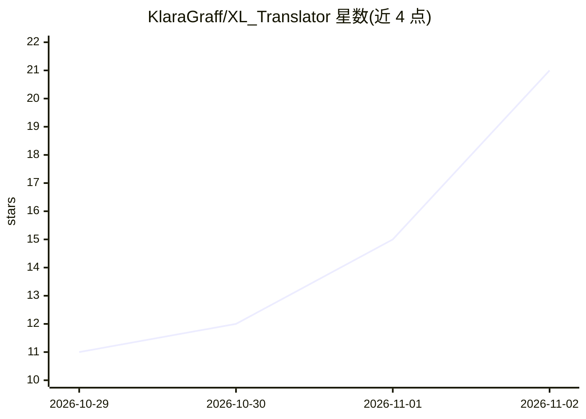

# KlaraGraff/XL_Translator

⭐ 21 · Python · MIT · 推送 2026-11-01 · [GitHub](https://github.com/KlaraGraff/XL_Translator) · [官网](https://github.com/KlaraGraff/XL_Translator/releases/latest) · 个人维护 · 中文 README

**面向桌面用户的 LLM 文档翻译应用：批量翻译 Excel/Word/PDF/CAD 图纸，双语对照输出**

开源桌面应用（Tauri 2 + TypeScript + Python），供 macOS 与 Windows 用户批量翻译 Excel、Word、PPT、PDF、图片、CAD 图纸（DWG/DXF）及字幕文件。文本翻译与图像翻译可分别配置云端（OpenAI、Claude、DeepSeek、智谱 GLM 等）或本地（Ollama、LM Studio）模型，文件读写均在本机完成。内置翻译记忆库复用译法、译后核对数字日期人名一致性、59 种语言与按文档类型的提示词补充要求。可作为 MCP 服务器供 Claude Desktop/Cursor 等智能体调用，同一程序亦可命令行使用。MIT 许可。

## 筛选速览

| 维度 | 判定 | 备注 |
|---|---|---|
| AI 角色 | `ai-native` | 本体是模型或模型工具 |
| 许可风险 | `permissive` | MIT |
| 部署形态 | `desktop` | 安装包/桌面程序 |
| 模型依赖 | local-ok | 支持本地模型 |
| 硬件要求 | — | 无带数字的原话,不猜 |
| 安装摩擦 | `low` | 无编译、无系统依赖或容器化 |
| 成熟度 | — | 结构信号不足 |

## 能力要点

- CAD 图纸（DWG/DXF）翻译写回，保留图层与排版，支持 GBK 中文编码旧图纸
- PDF 三种翻译方式：转 Word、原位替换、整页图像翻译（图像模型重绘）
- 翻译记忆库自动保存并复用译法，支持导入导出与清洗
- 可作为 MCP 服务器供 Claude Desktop/Claude Code/Cursor 等智能体调用

## 适用场景

- 批量翻译工程 CAD 图纸并生成双语对照图纸
- 翻译 Excel/Word/PPT 文档并保留格式，输出双语对照文件
- 通过智能体或命令行调用翻译能力自动处理文件
- 用本地模型（Ollama/LM Studio）翻译，使文档内容不离开本机

## 场景标签

 · 领域:文档翻译/桌面生产力工具

## 证据(README 行号)

> L5: Translator 是一款开源的、基于大语言模型的桌面文档翻译应用，支持批量翻译 **Excel、Word、PPT、PDF、图片、CAD 图纸（DWG / DXF）及字幕（SRT / VTT / ASS）**，适用于 macOS 
> L151: |云端|OpenAI / ChatGPT、Claude（Anthropic）、DeepSeek、智谱 GLM、阿里百炼（通义）、硅基流动，以及其他 OpenAI 兼容接口|

## 星数曲线

2026-10-29 11 → 2026-11-02 21（+10）

---
*卡片 v1 · prompt 1.4 · 生成 2026-10-31 · 置信度 high · 依据 README sha `b1aa1b374c5b` · [字段定义](../../DATASET.md)*
