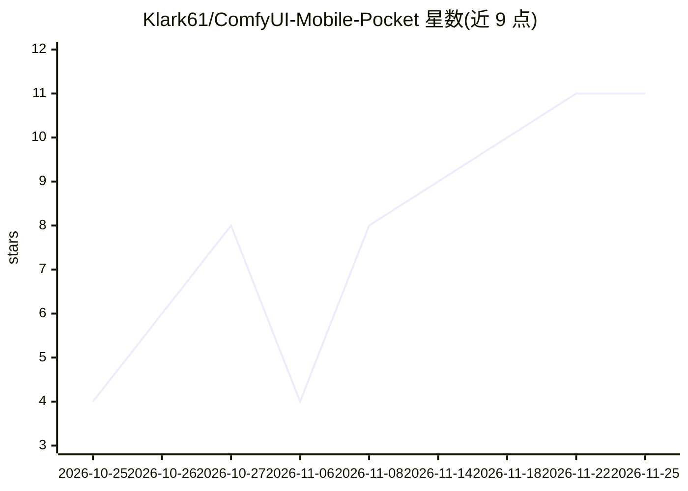

# Klark61/ComfyUI-Mobile-Pocket

⭐ 11 · JavaScript · MIT · 推送 2026-10-24 · [GitHub](https://github.com/Klark61/ComfyUI-Mobile-Pocket) · 个人维护

**手机上使用 ComfyUI 的移动端界面（Android/iOS）**

以 ComfyUI 自定义节点形式安装的移动端前端，提供两种入口：/pocket/ 手机应用（画廊、任务队列、Generate 表单页）与 /pocket/canvas 触屏版节点编辑器。Generate 读取已保存工作流并生成参数表单，可直接加载 API 格式工作流文件；Canvas 模式保留原编辑器行为，支持双指缩放、连线与自定义节点组件。需 ComfyUI 以 --listen 启动，README 提示无登录机制，建议仅在内网或 VPN/反向代理后使用。

## 筛选速览

| 维度 | 判定 | 备注 |
|---|---|---|
| AI 角色 | `ai-ecosystem` | LLM/agent 周边工具 |
| 许可风险 | `permissive` | MIT |
| 部署形态 | `None` |  |
| 模型依赖 | — | README 未给出锁定关系 |
| 硬件要求 | — | 无带数字的原话,不猜 |
| 安装摩擦 | `low` | 无编译、无系统依赖或容器化 |
| 成熟度 | — | 结构信号不足 |

## 能力要点

- 自定义节点安装，无需 pip 依赖，复用 ComfyUI 自带 aiohttp 与 Pillow
- Canvas 模式为完整 ComfyUI 编辑器加触控层，自定义节点组件可用
- Generate 从保存的工作流自动生成参数表单，支持 rgthree 分组开关与 LoRA 加载器
- 画廊支持元数据查看、收藏、搜索与工作流 Remix

## 适用场景

- 在手机上浏览、排队和管理 ComfyUI 生成任务
- 在手机上触屏编辑与运行已保存的 ComfyUI 工作流
- 用手机相机拍照作为 LoadImage 输入参与生成

## 场景标签

`图像生成` · 领域:内容生成

## 证据(README 行号)

> L3: A ComfyUI mobile UI for your phone (Android and iOS). Use ComfyUI from your phone with a fast mobile app for browsin
> L9: - **The phone app** at `/pocket/`. Gallery, live queue, and a Generate screen that reads your saved workflows and bu
> L10: - **Canvas mode** at `/pocket/canvas`. The actual ComfyUI editor with a phone layer on top, so every node and custo

## 星数曲线

2026-10-25 4 → 2026-11-25 11（+7）

---
*卡片 v1 · prompt 1.4 · 生成 2026-11-20 · 置信度 high · 依据 README sha `66db0c700597` · [字段定义](../../DATASET.md)*
