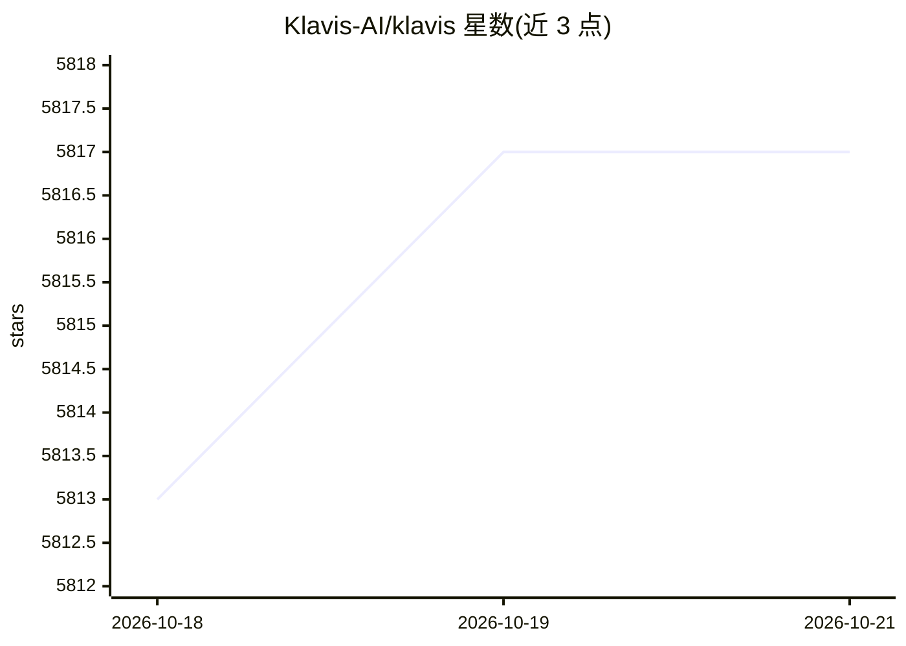

# Klavis-AI/klavis

⭐ 5,817 · Python · Apache-2.0 · 推送 2026-06-01 · [GitHub](https://github.com/Klavis-AI/klavis) · [官网](https://www.klavis.ai/) · 组织维护

**面向 AI agent 的 MCP 集成平台，提供工具接入与托管服务**

Klavis 团队维护的 MCP 集成平台，包含三部分：Strata（单一 MCP server 聚合数千工具、优化上下文窗口）、100+ 预构建 MCP 集成（含 OAuth 支持）、面向 LLM 训练与强化学习的 MCP Sandbox。提供云托管（klavis.ai）、Docker 自托管、Python/TypeScript SDK 与 REST API 四种使用方式。面向需要让 AI agent 可靠调用外部工具的开发者。

## 筛选速览

| 维度 | 判定 | 备注 |
|---|---|---|
| AI 角色 | `ai-ecosystem` | LLM/agent 周边工具 |
| 许可风险 | `permissive` | Apache-2.0 |
| 部署形态 | `self-host` | docker 或自建部署 |
| 模型依赖 | — | README 未给出锁定关系 |
| 硬件要求 | — | 无带数字的原话,不猜 |
| 安装摩擦 | `low` | 无编译、无系统依赖或容器化 |
| 成熟度 | — | 结构信号不足 |

## 能力要点

- Strata 单一 MCP server 聚合数千工具并优化上下文窗口
- 100+ 预构建 MCP 集成，支持 OAuth
- 提供云托管、Docker 自托管、SDK、REST API 四种接入方式
- MCP Sandbox：面向 LLM 训练与 RL 的可扩展 MCP 环境

## 适用场景

- 为 AI agent 接入 GitHub 等外部工具与 API
- 通过统一 MCP server 管理大量工具调用
- 自托管 MCP server 用于企业内部部署

## 场景标签

 · 领域:开发者工具/MCP 基础设施

## 证据(README 行号)

> L5: Strata - One&#0032;MCP&#0032;server&#0032;for&#0032;AI&#0032;agents&#0032;to&#0032;handle&#0032;thousands&#0032;of&#
> L16:  MCP Integrations
> L23:  MCP Sandbox

## 星数曲线

2026-10-18 5,813 → 2026-10-21 5,817（+4）

---
*卡片 v1 · prompt 1.4 · 生成 2026-10-20 · 置信度 high · 依据 README sha `fceccda44269` · [字段定义](../../DATASET.md)*
