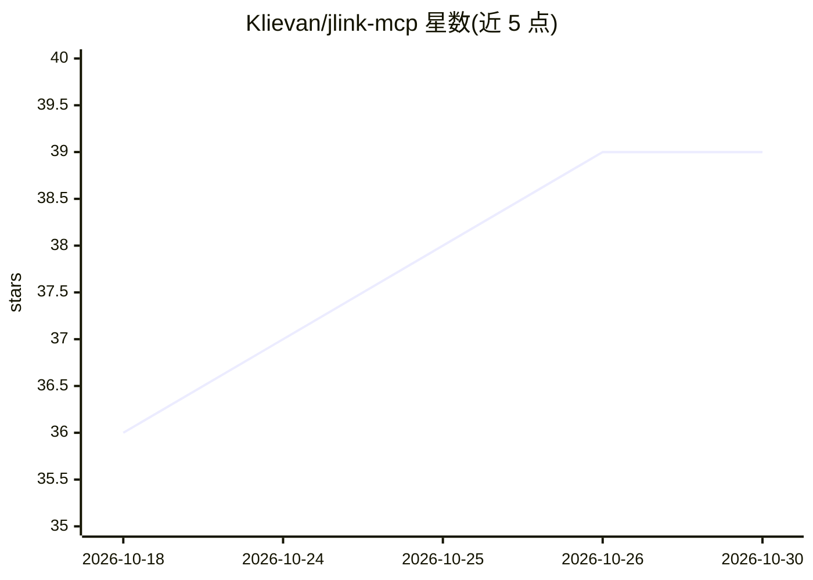

# Klievan/jlink-mcp

⭐ 39 · TypeScript · MIT · 推送 2026-10-26 · [GitHub](https://github.com/Klievan/jlink-mcp) · [官网](https://marketplace.visualstudio.com/items?itemName=Klievan.jlink-mcp) · 个人维护

**让 LLM 通过 MCP 直接操作 J-Link 等调试探针调试嵌入式设备**

TypeScript 实现的 MCP 服务器，把 SEGGER J-Link 调试探针（另支持 OpenOCD 与 Black Magic Probe 后端）以 48 个工具暴露给 AI 助手：读写寄存器与内存、烧录固件、halt/step/断点控制、启动 GDB server、流式读取 RTT 日志并按级别/模块/正则过滤、自动解码 ARM Cortex-M 故障寄存器，以及基于 CMSIS-SVD 文件解码外设寄存器。面向使用 Claude Code、Copilot 等 MCP 客户端的嵌入式开发者，需自备探针、目标板、J-Link 软件与 Node 18+；通过 npm/npx、Claude Code 插件市场、VS Code 扩展或 Nix 安装，无需构建步骤。

## 筛选速览

| 维度 | 判定 | 备注 |
|---|---|---|
| AI 角色 | `ai-ecosystem` | LLM/agent 周边工具 |
| 许可风险 | `permissive` | MIT |
| 部署形态 | `library` | 以包/库形式分发 |
| 模型依赖 | — | README 未给出锁定关系 |
| 硬件要求 | — | 无带数字的原话,不猜 |
| 安装摩擦 | `low` | 无编译、无系统依赖或容器化 |
| 成熟度 | — | 结构信号不足 |

## 能力要点

- 48 个 MCP 工具：烧录、断点、GDB server、寄存器与内存读写
- 自动解码 ARM Cortex-M 故障寄存器（CFSR/HFSR 等）并展开异常栈帧
- CMSIS-SVD 驱动的外设寄存器按字段名解码
- RTT 日志流式读取与按级别/模块/正则过滤
- 支持 J-Link（生产级）、OpenOCD 与 Black Magic Probe（均 Beta）后端

## 适用场景

- 让 AI 助手直接诊断固件崩溃并定位故障指令
- 通过对话烧录固件、控制执行与设置断点
- 在调试会话中流式读取并过滤 RTT 日志
- 按 CMSIS-SVD 解读外设寄存器数值含义

## 场景标签

 · 领域:嵌入式开发/调试工具

## 证据(README 行号)

> L63: **jlink-mcp** connects AI assistants (Claude, Copilot, etc.) to your embedded hardware via SEGGER J-Link debug prob
> L145: ## Tools (48)

## 星数曲线

2026-10-18 36 → 2026-10-30 39（+3）

---
*卡片 v1 · prompt 1.4 · 生成 2026-10-25 · 置信度 high · 依据 README sha `a5997e1eecea` · [字段定义](../../DATASET.md)*
