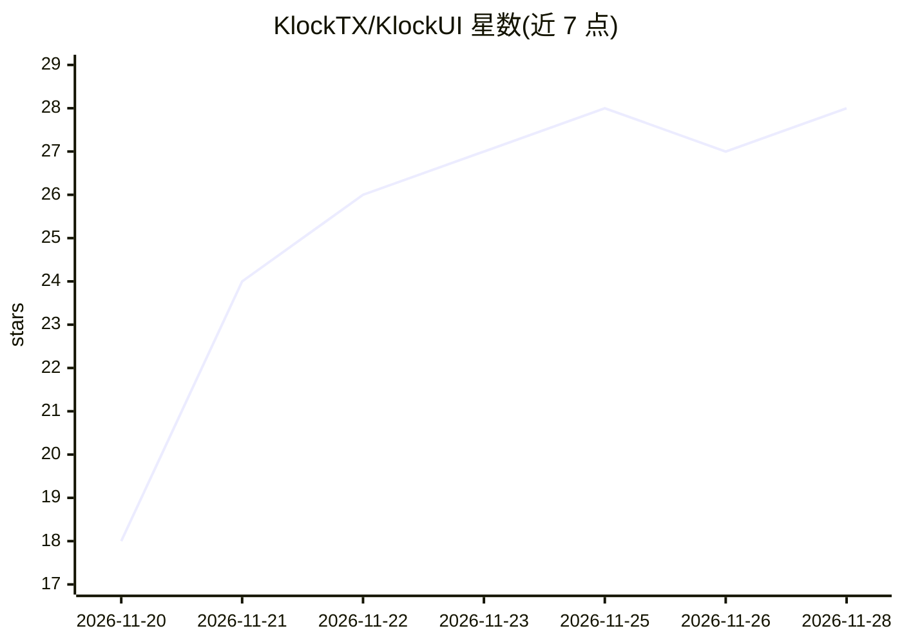

# KlockTX/KlockUI

⭐ 28 · JavaScript · NOASSERTION · 推送 2026-11-22 · [GitHub](https://github.com/KlockTX/KlockUI) · [官网](https://github.com/KlockTX/KlockUI/releases/latest) · 个人维护 · 中文 README

**本地 AI 出图工作台：把 ComfyUI 封装成表单式界面**

纯 Python + 原生前端的本地应用，不自带推理引擎与模型权重，通过连接本机 ComfyUI 出图；核心机制是把各架构（Anima、Z-Image、Krea 2、MOSS-Image、SDXL 系）的采样器/调度器/步数/CFG 等参数固化为代码中的架构知识，按权重张量名自动识别底模并套用配置，LoRA 按架构隔离，参数配方可导出 JSON 分享。面向 8–16GB 显存的消费级显卡用户，安装流程设计为由 agent 按 install.md/skill.md 引导执行，仅在 Windows + NVIDIA 上验证过。

## 筛选速览

| 维度 | 判定 | 备注 |
|---|---|---|
| AI 角色 | `ai-native` | 本体是模型或模型工具 |
| 许可风险 | `viral` | NOASSERTION |
| 部署形态 | `library` | 以包/库形式分发 |
| 模型依赖 | — | README 未给出锁定关系 |
| 硬件要求 | `gpu-8g` | |
| 安装摩擦 | `low` | 无编译、无系统依赖或容器化 |
| 成熟度 | — | 结构信号不足 |

## 能力要点

- 按权重张量名识别底模架构，自动配置采样参数
- LoRA 按架构隔离，支持搜索与单独权重调节
- 参数配方导出/导入 JSON，内置 26 个示例预设
- 全本机运行，无账号、无遥测、无云端调用

## 适用场景

- 在消费级显卡上本地批量出图而不用手调 ComfyUI 节点
- 多底模切换时避免采样器/CFG 配错出糊图
- 与朋友分享一套可复现的出图参数配方
- 整理管理大量二次元画师 LoRA 并按架构调用

## 场景标签

`图像生成` · 领域:内容生成

## 证据(README 行号)

> L3: **把 ComfyUI 包成一个能直接用的本地出图工作台。** 填提示词、点生成，其余全在界面上。
> L44: 选定底模，采样器、调度器、步数、CFG、shift、文本编码器类型、VAE 全部自动就位。
> L136: 三个进程都在本机：浏览器只是界面，KlockUI 负责把表单翻译成节点图，ComfyUI 执行，GPU 出图。

## 星数曲线

2026-11-20 18 → 2026-11-28 28（+10）

---
*卡片 v1 · prompt 1.4 · 生成 2026-11-20 · 置信度 mid · 依据 README sha `c985105ce519` · [字段定义](../../DATASET.md)*
