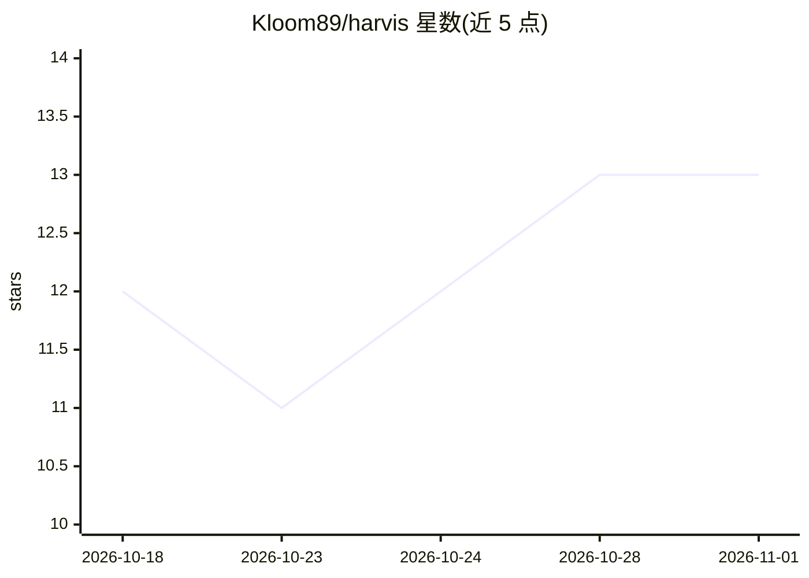

# Kloom89/harvis

⭐ 13 · Python · NOASSERTION · 推送 2026-08-20 · [GitHub](https://github.com/Kloom89/harvis) · [官网](https://kloomstudio.com.ar) · 组织维护

**Windows 语音 AI 助手：本地唤醒+自选 LLM，语音操作电脑**

面向个人用户的 Windows 语音助手：本地 Whisper 完成唤醒词与语音识别（音频不出本机），对话与思考交给用户自带的 LLM（Claude/Groq/Ollama/OpenAI/Gemini/Kimi，可语音中途切换）。工具层可开应用、控音乐、读 Teams、起草 WhatsApp、视觉读屏解释报错、SSH 查看容器等；新增能力只需在 skills/ 放一个 Python 文件并热加载。每轮对话记录到 turnos.jsonl 便于调试。要求 Windows 11、Python 3.12+、麦克风，建议 NVIDIA GPU。采用 PolyForm Noncommercial 许可，个人使用免费、不可商用。

## 筛选速览

| 维度 | 判定 | 备注 |
|---|---|---|
| AI 角色 | `ai-native` | 本体是模型或模型工具 |
| 许可风险 | `none` | NOASSERTION |
| 部署形态 | `desktop` | 安装包/桌面程序 |
| 模型依赖 | local-ok | 支持本地模型 |
| 硬件要求 | — | 无带数字的原话,不猜 |
| 安装摩擦 | `low` | 无编译、无系统依赖或容器化 |
| 成熟度 | — | 结构信号不足 |

## 能力要点

- 本地 Whisper 唤醒与识别，音频不出本机，可录制 6 次声音自校准
- 六种可切换的 LLM 大脑，无凭据内置、密钥存环境变量
- 工具可实际操作 PC：开应用、控音乐、读 Teams、视觉读屏、SSH 查容器
- skills/ 单文件扩展技能，HUD 热加载安装

## 适用场景

- 用语音让 AI 打开应用、放歌、控制音量
- 让助手读屏解释报错或读出 Teams 消息
- 通过 Telegram 用文字或语音远程指挥助手
- 写一个 Python 技能文件教它新本事

## 场景标签

`语音 Agent` `AI 助手` `GUI 自动化` · 领域:效率与自动化

## 证据(README 行号)

> L25: Say its name and it wakes up **on your machine** — no cloud microphone, no
> L30: **You pick the brain.** Claude, Groq, Ollama, OpenAI, Gemini, Kimi — HARVIS
> L52: |*"…take a screenshot and tell me what this error is"*|Captures the screen, sends it to a vision model, explains th

## 星数曲线

2026-10-18 12 → 2026-11-01 13（+1）

---
*卡片 v1 · prompt 1.4 · 生成 2026-10-31 · 置信度 mid · 依据 README sha `08e259e5da82` · [字段定义](../../DATASET.md)*
