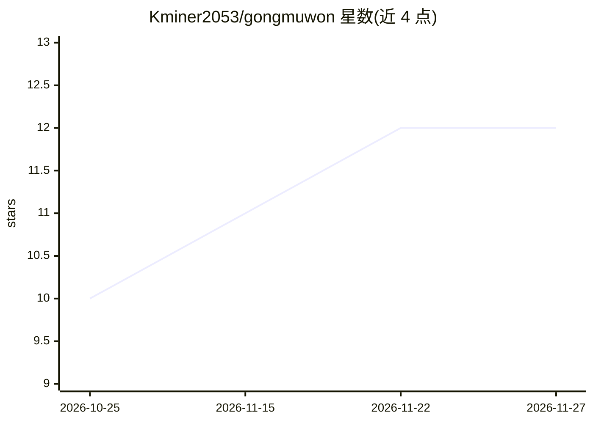

# Kminer2053/gongmuwon

⭐ 12 · Python · NOASSERTION · 推送 2026-08-13 · [GitHub](https://github.com/Kminer2053/gongmuwon) · [官网](https://kminer2053.github.io/gongmuwon/) · 个人维护

**给内网/离线环境公务员的本地 AI 工作台：问答、检索、日程、公文生成**

面向韩国公共机构办公人员的 Windows 桌面应用（Tauri + React + FastAPI），在无互联网环境本地运行轻量模型。核心流程：对话提问 → 从本地知识文件夹索引中检索并附出处回答 → 一键生成 HWPX（韩文 Hangul）文档；另含日程与提醒、自动知识 wiki（SQLite FTS5 三元组索引、韩文支持）、增量同步与执行记录。数据全部存于本地 PC，索引在原文件夹进行不上传。支持本地 Ollama（捆绑 gemma-4 E2B 模型）或外部 API。应用代码 MIT，捆绑组件各有独立许可。

## 筛选速览

| 维度 | 判定 | 备注 |
|---|---|---|
| AI 角色 | `ai-native` | 本体是模型或模型工具 |
| 许可风险 | `none` | NOASSERTION |
| 部署形态 | `desktop` | 安装包/桌面程序 |
| 模型依赖 | local-ok | 支持本地模型 |
| 硬件要求 | — | 无带数字的原话,不猜 |
| 安装摩擦 | `low` | 无编译、无系统依赖或容器化 |
| 成熟度 | — | 结构信号不足 |

## 能力要点

- 无互联网环境运行：捆绑 Ollama 与本地轻量多模态模型，数据不出 PC
- 从本地知识文件夹检索并给出文件级出处引用
- 对话直接生成 HWPX 公文（含公文/单页/全文/邮件及自定义模板填空）
- 业务文件夹原位索引、增量同步与按任务自动生成知识 wiki

## 适用场景

- 内网/保密环境中向本地 AI 提问并要求引用内部资料作答
- 对话内容直接转成符合格式的韩文公文
- 把杂乱的业务文档文件夹索引成可检索的知识库
- 以对话方式登记日程并接收提醒

## 场景标签

`文档问答` `AI 助手` `AI 写作` `知识库管理` · 领域:对话与助手

## 证据(README 行号)

> L3: **인터넷 없이, 내 PC 안에서 도는 공무원 업무 AI 워크스페이스**
> L48: |**어&#8288;디&#8288;서 도&#8288;나**|Windows 10/11 x64 데스크톱. **인터넷 불필요**(로컬 LLM 동봉)|
> L157: - **지식위키**: 지정한 업무 폴더를 그 자리에서 색인해 SQLite FTS5(트라이그램, 한국어 대응)로 검색하고, 업무별 위키 md를 파생 생성. 경량 LLM-wiki 방식.

## 星数曲线

2026-10-25 10 → 2026-11-27 12（+2）

---
*卡片 v1 · prompt 1.4 · 生成 2026-11-19 · 置信度 high · 依据 README sha `b7c1072171cb` · [字段定义](../../DATASET.md)*
