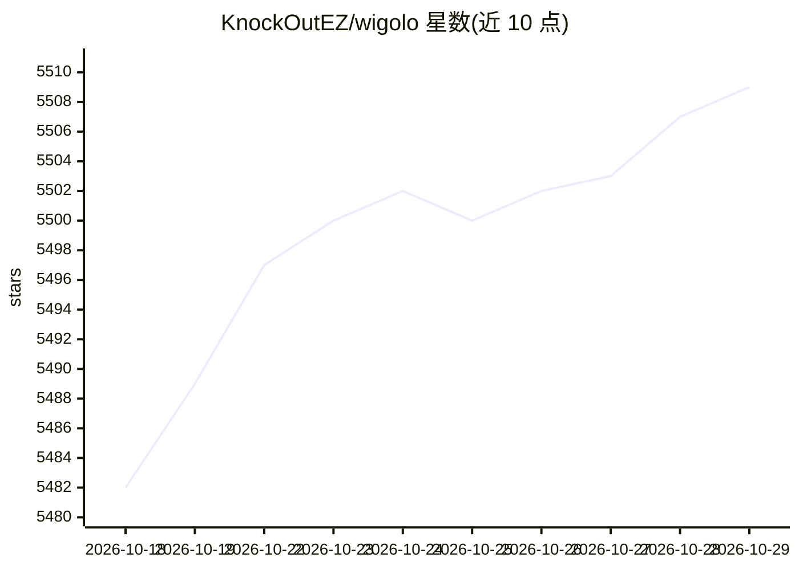

# KnockOutEZ/wigolo

⭐ 5,509 · TypeScript · NOASSERTION · 推送 2026-10-28 · [GitHub](https://github.com/KnockOutEZ/wigolo) · [官网](https://wigolo.app) · 个人维护

**面向 AI 编程代理的本地优先网络搜索/抓取/爬取 MCP 工具服务器**

wigolo 为 AI coding agent 与自托管 agent 提供统一的网络访问层：通过 MCP、REST、CLI 与 TypeScript/Python SDK 暴露 search、fetch、crawl、extract、cache、find_similar、research、agent 等工具。搜索、抓取、爬取等核心工具无需 API key，重排序与嵌入在本地设备运行，缓存与模型存放于 ~/.wigolo/；research/agent 等综合类工具可选配置 LLM（Gemini/Anthropic/OpenAI/Groq 或本地 Ollama）。一条命令接入 Claude Code、Cursor、Codex 等代理，需 Node ≥ 20 与约 1.5 GB 磁盘。

## 筛选速览

| 维度 | 判定 | 备注 |
|---|---|---|
| AI 角色 | `ai-ecosystem` | LLM/agent 周边工具 |
| 许可风险 | `none` | NOASSERTION |
| 部署形态 | `self-host` | docker 或自建部署 |
| 模型依赖 | local-ok | 支持本地模型 |
| 硬件要求 | — | 无带数字的原话,不猜 |
| 安装摩擦 | `low` | 无编译、无系统依赖或容器化 |
| 成熟度 | — | 结构信号不足 |

## 能力要点

- 核心 search/fetch/crawl/extract/cache/find_similar 全程无 API key，本地运行
- 18 个直连搜索引擎适配 + 排序融合 + 本地 ML 重排序，带逐条可解释评分
- 一条 npx 命令完成本地引擎初始化并接入 9 种 coding agent
- MCP / REST / CLI / TS 与 Python SDK 多种暴露方式，可选 Ollama 本地 LLM 做综合

## 适用场景

- 给 Claude Code、Cursor 等编程代理配备免 key 的网页搜索与抓取工具
- 自托管 agent 通过 REST 端点复用同一套网络工具
- 在 RAG 或研究流程中做带引用的研究报告生成

## 场景标签

`网页抓取` `语义搜索` · 领域:效率与自动化

## 证据(README 行号)

> L32: wigolo gives an AI agent one surface for everything web-related: **search, fetch, crawl, extract, cache, find-simil
> L45: - **Supported agents** — `--agents` takes any of `claude-code` · `cursor` · `codex` · `gemini-cli` · `opencode` · `

## 星数曲线

2026-10-18 5,482 → 2026-10-29 5,509（+27）

---
*卡片 v1 · prompt 1.4 · 生成 2026-10-20 · 置信度 mid · 依据 README sha `e73b1e0943a9` · [字段定义](../../DATASET.md)*
