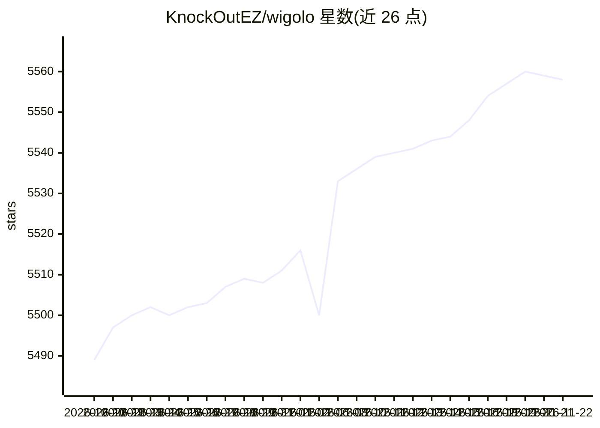

# KnockOutEZ/wigolo

⭐ 5,558 · TypeScript · NOASSERTION · 推送 2026-11-21 · [GitHub](https://github.com/KnockOutEZ/wigolo) · [官网](https://wigolo.app) · 个人维护

**为 AI 编码代理提供本地化网页搜索抓取研究的 MCP 服务**

以 MCP 服务器、REST API、CLI 和 SDK 形式运行的网络工具层，为 AI 代理提供 search、fetch、crawl、extract、cache、find_similar、research、agent、diff、watch 十个工具。默认通过直连公共引擎的适配器搜索，重排与嵌入在设备端运行，无需 API key，缓存与模型存放于 ~/.wigolo/。research/agent 等合成功能可选接入 LLM（Gemini/Anthropic/OpenAI/Groq 或本地 ollama），否则返回原始证据由宿主代理自行组织。要求 Node ≥ 20 与约 1.5 GB 磁盘，支持 macOS/Linux/Windows。

## 筛选速览

| 维度 | 判定 | 备注 |
|---|---|---|
| AI 角色 | `ai-ecosystem` | LLM/agent 周边工具 |
| 许可风险 | `none` | NOASSERTION |
| 部署形态 | `self-host` | docker 或自建部署 |
| 模型依赖 | local-ok | 支持本地模型 |
| 硬件要求 | — | 无带数字的原话,不猜 |
| 安装摩擦 | `low` | 无编译、无系统依赖或容器化 |
| 成熟度 | `idea` | |

## 能力要点

- 十个网络工具经 MCP、REST、CLI、TypeScript/Python SDK 暴露
- 默认路径无需 API key，搜索走 18 个直连引擎适配器并做秩融合
- fetch 通过分层路由从 HTTP 升级到无头浏览器以处理反爬与 SPA
- init 一条命令可同时为 claude-code、cursor 等九种代理写入 MCP 配置

## 适用场景

- 给 Claude Code/Cursor 等编码代理接入本地网页搜索与抓取
- 自托管代理经 REST API 调用网页研究能力
- 本地 RAG 流程中做网页检索与相似页面查找

## 场景标签

`网页抓取` `语义搜索` · 领域:效率与自动化

## 证据(README 行号)

> L32: wigolo gives an AI agent one surface for everything web-related: **search, fetch, crawl, extract, cache, find-simil
> L87: |🔎 `search`|Multi-engine web search (18 direct adapters) with rank fusion, ML reranking, and an explainable per-res
> L97: Every tool also runs from the terminal (`wigolo search "…" --json`), from an interactive shell with NDJSON piping (

## 星数曲线

2026-10-20 5,489 → 2026-11-22 5,558（+69）

---
*卡片 v1 · prompt 1.4 · 生成 2026-11-22 · 置信度 high · 依据 README sha `ce26b47e987a` · [字段定义](../../DATASET.md)*
