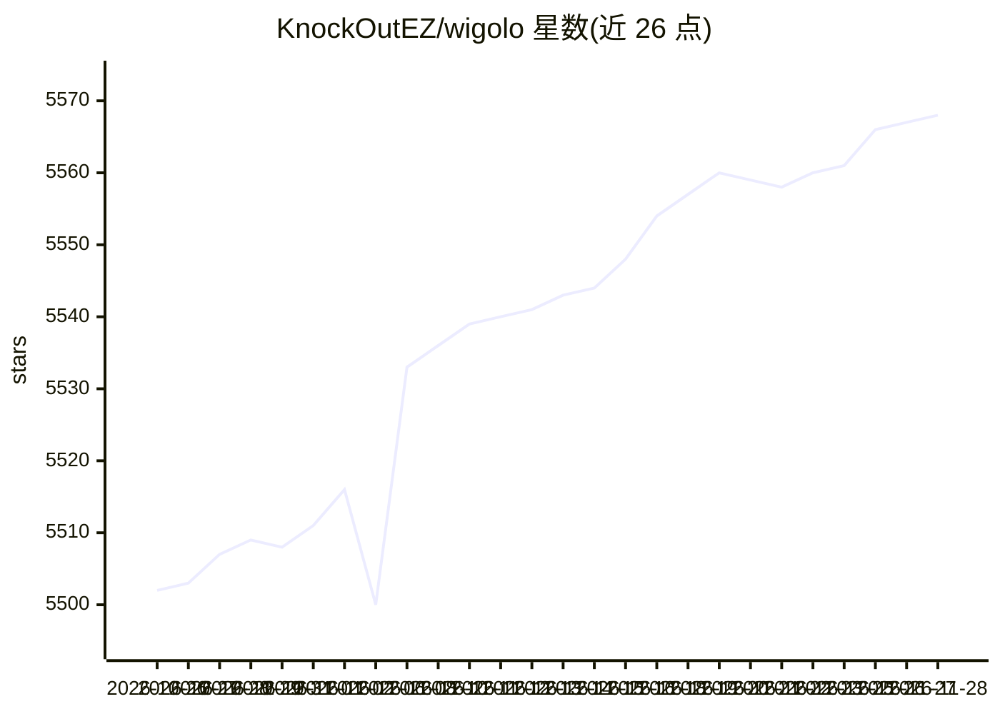

# KnockOutEZ/wigolo

⭐ 5,568 · TypeScript · NOASSERTION · 推送 2026-11-27 · [GitHub](https://github.com/KnockOutEZ/wigolo) · [官网](https://wigolo.app) · 个人维护

**给 AI coding agent 的本地优先网页工具层：搜索/抓取/爬取/研究**

wigolo 以 MCP 服务器、REST API（OpenAPI 3.1 契约）及 TypeScript/Python SDK 形式，为 AI agent 提供十项网页工具：多引擎搜索（18 个直连适配器+排序融合+本地重排）、分层路由的 fetch、爬取、结构化抽取、本地缓存、find_similar、研究与自主收集循环。核心工具无需 API key，数据留在 ~/.wigolo/。synthesis 类功能需配置 LLM provider（可接 ollama 保持全本地）。要求 Node ≥ 20、约 1.5GB 磁盘，支持 macOS/Linux/Windows，提供 Docker、Homebrew 与单文件二进制安装渠道。

## 筛选速览

| 维度 | 判定 | 备注 |
|---|---|---|
| AI 角色 | `ai-ecosystem` | LLM/agent 周边工具 |
| 许可风险 | `none` | NOASSERTION |
| 部署形态 | `self-host` | docker 或自建部署 |
| 模型依赖 | local-ok | 支持本地模型 |
| 硬件要求 | — | 无带数字的原话,不猜 |
| 安装摩擦 | `low` | 无编译、无系统依赖或容器化 |
| 成熟度 | `idea` | |

## 能力要点

- 十项工具覆盖 search/fetch/crawl/extract/cache/find_similar/research/agent/diff/watch
- 核心工具完全免 API key，重排器与嵌入模型在本地运行
- 结果携带字节偏移固定的逐字摘录、引用 ID 与可解释分数分解
- 同时暴露 MCP、REST、CLI、交互 shell 与 SDK 多种调用面

## 适用场景

- 让 Claude Code/Cursor 等 coding agent 通过 MCP 检索实时网页资料
- 自托管 agent 通过本地 REST API 做网页抓取与研究
- 为 LangChain 等 RAG 流水线提供网页检索与相似页工具
- 监控页面变化并通过 webhook 推送变更

## 场景标签

`网页抓取` `RAG` · 领域:效率与自动化

## 证据(README 行号)

> L32: wigolo gives an AI agent one surface for everything web-related: **search, fetch, crawl, extract, cache, find-simil
> L103: - **Built for agents.** One MCP call fans out many queries across many engines in parallel, which a serial host to
> L142: The same ten tools serve every kind of agent, over whichever surface fits: MCP for coding agents, REST for everyth

## 星数曲线

2026-10-26 5,502 → 2026-11-28 5,568（+66）

---
*卡片 v1 · prompt 1.4 · 生成 2026-11-26 · 置信度 mid · 依据 README sha `fd63790ce2b7` · [字段定义](../../DATASET.md)*
