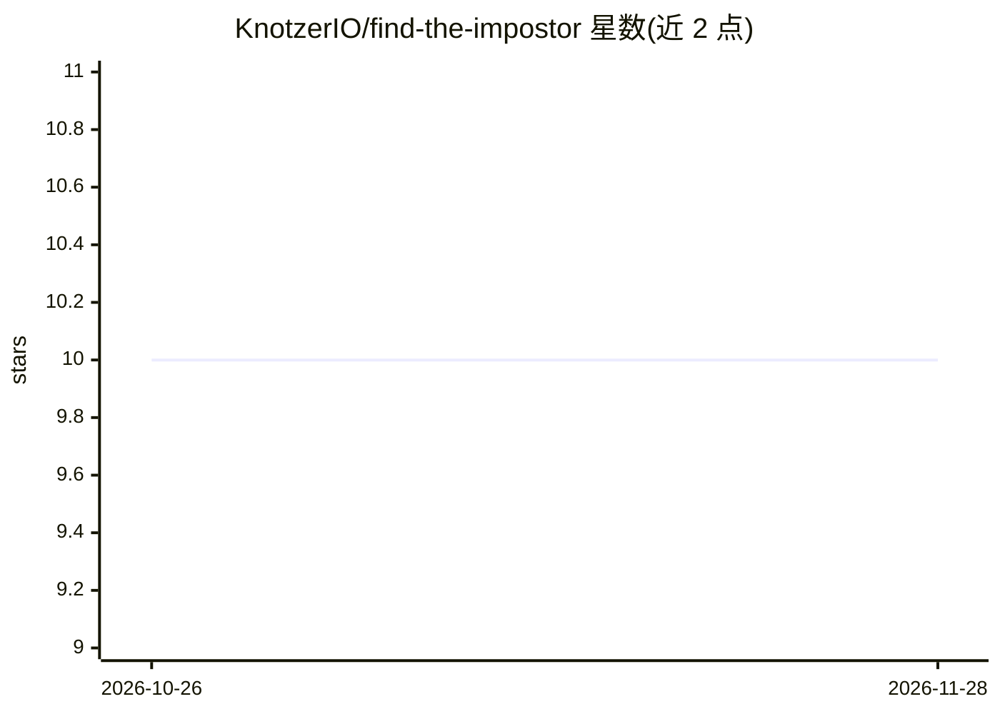

# KnotzerIO/find-the-impostor

⭐ 10 · TypeScript · MIT · 推送 2026-02-16 · [GitHub](https://github.com/KnotzerIO/find-the-impostor) · [官网](https://impostor.knotzer.io) · 组织维护

**AI 生成词库的多人派对词联想游戏（PWA）**

本地优先的多人派对 PWA：3-10 名玩家中若干名“卧底”不知道秘密词，普通玩家轮流说出与秘密词相关的单词，随后投票找出卧底；支持自定义类别、卧底数量（1-3）、可选提示、英德双语（next-intl），游戏数据经 IndexedDB 本地存储，可安装到主屏幕并离线游玩。词库可由 AI 生成，README 注明 AI 演示依赖个人预算、额度用尽时会回退到备用词。安装方式为 git clone 后 npm/yarn/pnpm 运行，需 Node.js 18+。

## 筛选速览

| 维度 | 判定 | 备注 |
|---|---|---|
| AI 角色 | `ai-enhanced` | 去掉 AI 部分产品仍成立 |
| 许可风险 | `permissive` | MIT |
| 部署形态 | `None` |  |
| 模型依赖 | — | README 未给出锁定关系 |
| 硬件要求 | — | 无带数字的原话,不猜 |
| 安装摩擦 | `low` | 无编译、无系统依赖或容器化 |
| 成熟度 | — | 结构信号不足 |

## 能力要点

- 卧底词联想玩法：普通玩家见秘密词，卧底仅见类别提示
- 可配置玩家数（3-10）、卧底数（1-3）、类别与难度
- PWA 可安装、离线优先、数据本地存于 IndexedDB
- 英语与德语双语支持（next-intl）

## 适用场景

- 线下聚会时用手机轮流传看设备玩卧底猜词
- 无网络环境下离线进行派对游戏
- 自定义词类别与难度组织多人对局

## 场景标签

 · 领域:游戏/桌面与移动应用

## 证据(README 行号)

> L13: **A local-first party game PWA where players guess the secret word while impostors try to blend in**
> L18: > The AI demo is currently running on a personal budget, which has now been used up, so you might notice some error
> L74: - **🔌 Offline First**: Play without internet connection

## 星数曲线

2026-10-26 10 → 2026-11-28 10（+0）

---
*卡片 v1 · prompt 1.4 · 生成 2026-11-20 · 置信度 high · 依据 README sha `3a6bc7615f69` · [字段定义](../../DATASET.md)*
