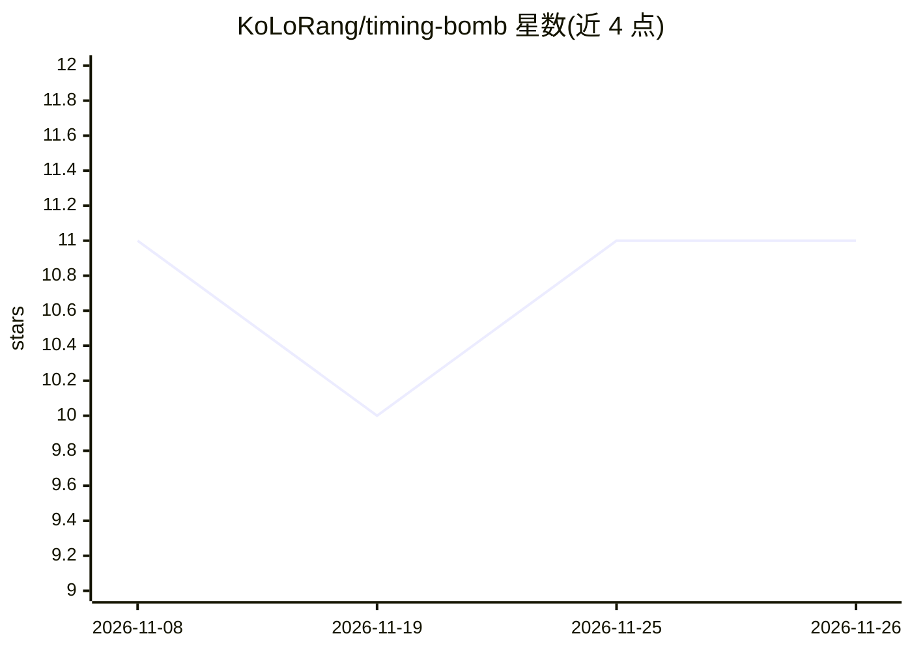

# KoLoRang/timing-bomb

⭐ 11 · Swift · 推送 2026-11-12 · [GitHub](https://github.com/KoLoRang/timing-bomb) · [官网](https://timing-bomb.pages.dev/) · 个人维护 · 中文 README

**macOS 本地自动化编排器，可视化流程+定时+文件监听+AI Agent 接入**

把可重复的 Mac 任务打包为可执行工作流：TimingBomb.app 与本地守护进程负责触发（手动/webhook/定时/文件监听）与执行，Flow JSON 存储节点定义，`tb` CLI 通过本地或远程 API 校验、保存与运行流程。流程内承载确定性逻辑（条件/循环/重试/审批/文件操作），AI Agent 通过配套 Skill 以固定工作流接入，仅在需要推理或决策时调用本地工具。macOS 14+、Apple Silicon（DMG）运行，CLI 跨平台经 npm 分发。

## 筛选速览

| 维度 | 判定 | 备注 |
|---|---|---|
| AI 角色 | `ai-enhanced` | 去掉 AI 部分产品仍成立 |
| 许可风险 | `none` | — |
| 部署形态 | `desktop` | 安装包/桌面程序 |
| 模型依赖 | — | README 未给出锁定关系 |
| 硬件要求 | — | 无带数字的原话,不猜 |
| 安装摩擦 | `low` | 无编译、无系统依赖或容器化 |
| 成熟度 | — | 结构信号不足 |

## 能力要点

- 四种触发器：手动、webhook、定时（cron/一次性）、递归文件监听（带 debounce）
- 可视化流程编辑器，支持 code/if/loop/action/approval 节点与可复用收藏节点
- AI Agent Skill 定义标准化工作契约，兼容 codex/claude-code/cursor 等 Agent
- 安全控制：默认回环绑定、token 认证、shell/AppleScript 白名单、dry-run

## 适用场景

- 把定时任务和文件到达触发的多步骤流程固化为工作流
- 让 AI Agent 按固定契约准备一次流程，由本地服务重复执行
- 通过 webhook 和审批节点搭建需要人工确认的本地自动化

## 场景标签

`工作流自动化` · 领域:效率与自动化

## 证据(README 行号)

> L9: TimingBomb turns repeatable Mac tasks into executable workflows. Build a flow
> L10: once, let the local service handle triggers and execution, and use an AI Agent
> L14: your Mac, the `tb` CLI controls it, and the TimingBomb Skill gives AI Agents a
> L133: - macOS 14 or later for the TimingBomb app and service.

## 星数曲线

2026-11-08 11 → 2026-11-26 11（+0）

---
*卡片 v1 · prompt 1.4 · 生成 2026-11-20 · 置信度 high · 依据 README sha `84984a1d5c05` · [字段定义](../../DATASET.md)*
