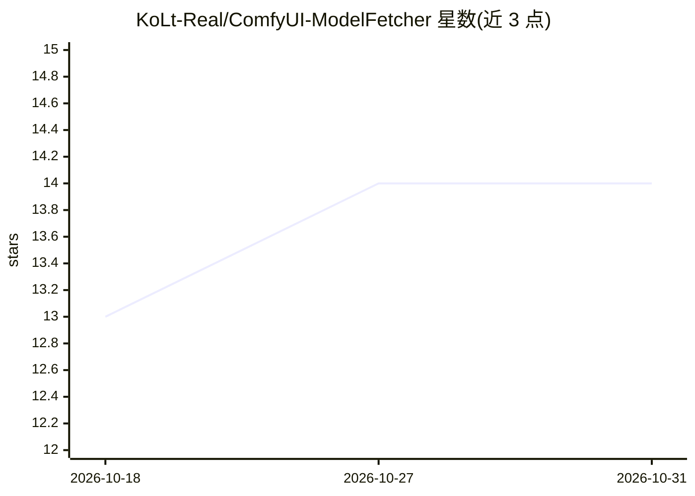

# KoLt-Real/ComfyUI-ModelFetcher

⭐ 14 · Python · Apache-2.0 · 推送 2026-10-20 · [GitHub](https://github.com/KoLt-Real/ComfyUI-ModelFetcher) · 个人维护

**ComfyUI 插件：读取工作流笔记，自动下载缺失模型并重链接已有副本**

ComfyUI 顶栏按钮插件：解析当前工作流 MarkdownNote/Note 节点（含子图）中的 Model Link(s) 笔记，提取 checkpoint、VAE、文本编码器等模型链接，对照磁盘（含 extra_model_paths.yaml 的额外根目录）分类为已安装/疑似重复/缺失等状态，一键下载缺失模型到正确目录；对已存在于子文件夹的同名同大小副本提供 Relink 重写 loader 节点而非重复下载。下载支持断点续传（.part 文件 + Range）、取消与进度推送，并处理 HuggingFace 门控模型令牌。面向 ComfyUI 工作流使用者。

## 筛选速览

| 维度 | 判定 | 备注 |
|---|---|---|
| AI 角色 | `ai-ecosystem` | LLM/agent 周边工具 |
| 许可风险 | `permissive` | Apache-2.0 |
| 部署形态 | `library` | 以包/库形式分发 |
| 模型依赖 | — | README 未给出锁定关系 |
| 硬件要求 | — | 无带数字的原话,不猜 |
| 安装摩擦 | `low` | 无编译、无系统依赖或容器化 |
| 成熟度 | — | 结构信号不足 |

## 能力要点

- 解析工作流 Markdown 笔记提取模型清单，含子图与两种笔记风格
- Relink 重写 loader 节点指向子文件夹中的已有副本，避免重复下载
- 可恢复下载（.part + Range 头），原子重命名，websocket 实时进度
- HuggingFace 门控模型令牌管理（仅发送至 HF 主机，0600 权限保存）

## 适用场景

- 导入 ComfyUI 模板工作流时一键补齐缺失模型
- 避免重复下载已存于子文件夹的同名模型，用 Relink 修复引用
- 下载 HuggingFace 门控模型并安全保存访问令牌

## 场景标签

 · 领域:AI 工具链/模型管理

## 证据(README 行号)

> L3: A top-bar button for ComfyUI that reads the **Markdown notes** of the open workflow, extracts
> L160: **Via ComfyUI Manager** — search for *Model Fetcher* in the Manager's custom-node list, or

## 星数曲线

2026-10-18 13 → 2026-10-31 14（+1）

---
*卡片 v1 · prompt 1.4 · 生成 2026-10-31 · 置信度 mid · 依据 README sha `cc3a6ea3699b` · [字段定义](../../DATASET.md)*
