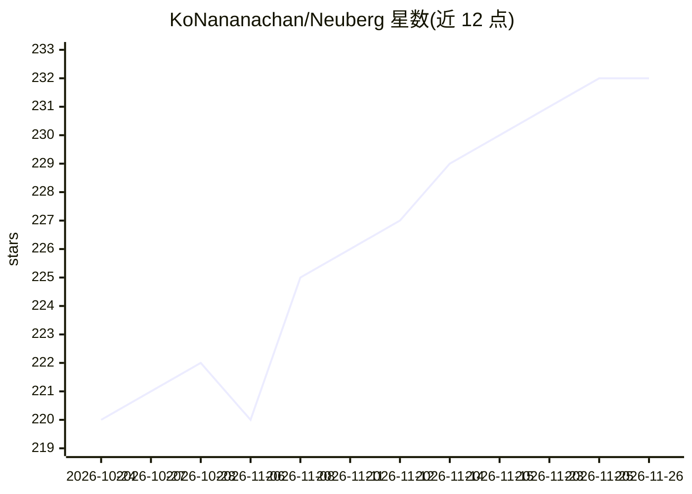

# KoNananachan/Neuberg

⭐ 232 · TypeScript · NOASSERTION · 推送 2026-11-02 · [GitHub](https://github.com/KoNananachan/Neuberg) · [官网](https://neuberg.ai) · 个人维护

**开源自托管金融终端：516 个数据面板+AI 新闻分析+多资产交易**

以 Web 形式运行的开源金融终端，宣称覆盖 Bloomberg Terminal 的功能范围：提供 516 个可拖拽布局的市场数据面板（股票、固收、外汇、商品、宏观、衍生品、另类数据），数据取自 Yahoo Finance、CoinGecko 等。内置交易接口：Alpaca 美股（实盘/模拟）、Hyperliquid 加密永续合约、Polymarket 预测市场。AI 部分对新闻文章做情感、地点与冲突检测，并将相关文章聚类成故事；AI 后端接受 OpenAI 兼容 API（Gemini、GPT 或本地模型）。前端 React 19，后端 Express 5 + Prisma(SQLite)，支持 Docker 部署。采用 Business Source License 1.1 许可。

## 筛选速览

| 维度 | 判定 | 备注 |
|---|---|---|
| AI 角色 | `ai-enhanced` | 去掉 AI 部分产品仍成立 |
| 许可风险 | `none` | NOASSERTION |
| 部署形态 | `library` | 以包/库形式分发 |
| 模型依赖 | — | README 未给出锁定关系 |
| 硬件要求 | — | 无带数字的原话,不猜 |
| 安装摩擦 | `low` | 无编译、无系统依赖或容器化 |
| 成熟度 | — | 结构信号不足 |

## 能力要点

- 516 个拖拽式市场数据面板，按需加载减少 API 调用
- 一个界面内交易美股（Alpaca）、加密永续（Hyperliquid）、预测市场（Polymarket）
- AI 新闻情感分析与冲突地图，支持 Gemini/GPT/本地模型的 OpenAI 兼容 API
- WebSocket 实时数据与 6 语言界面

## 适用场景

- 在浏览器里替代付费金融终端查看多资产实时行情
- 从同一界面执行美股、加密永续与预测市场交易
- 用 AI 自动分析财经新闻的情感与冲突事件

## 场景标签

`金融量化` · 领域:学习与行业

## 证据(README 行号)

> L18: Neuberg is building the **all-in-one financial terminal** that Bloomberg charges $24,000/year for — but open-source
> L83: - **AI News Analysis** — Every article analyzed for sentiment, location, and conflict detection
> L96: |**AI**|OpenAI-compatible API (Gemini, GPT, or local models)|

## 星数曲线

2026-10-24 220 → 2026-11-26 232（+12）

---
*卡片 v1 · prompt 1.4 · 生成 2026-11-25 · 置信度 high · 依据 README sha `509d1655b1d9` · [字段定义](../../DATASET.md)*
