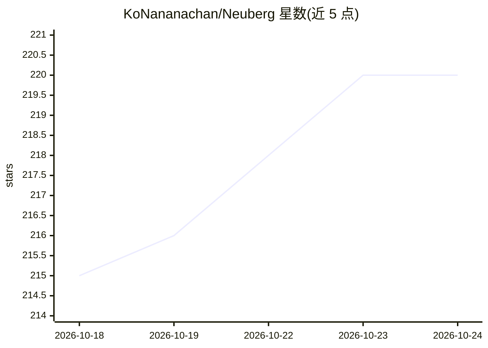

# KoNananachan/Neuberg

⭐ 220 · TypeScript · NOASSERTION · 推送 2026-05-24 · [GitHub](https://github.com/KoNananachan/Neuberg) · [官网](https://neuberg.ai) · 个人维护 · 中文 README

**开源网页版金融终端：516 个面板、实时数据与多资产交易**

面向个人交易者的 Web 端金融终端，提供 516 个可拖拽面板，数据来自 Yahoo Finance、CoinGecko、Polymarket、Hyperliquid，覆盖股票、固收、外汇、大宗商品、宏观与衍生品等类别。内置交易功能：Alpaca 美股、Hyperliquid 49 个加密永续、Polymarket 预测市场。AI 部分为新闻情感分析、新闻聚类与冲突地图，通过 OpenAI 兼容 API 接入 Gemini/GPT 或本地模型。技术栈 React 19 + Express 5，用 git clone 与 npm 安装运行，采用 Business Source License 1.1 许可（非 OSI 开源许可）。

## 筛选速览

| 维度 | 判定 | 备注 |
|---|---|---|
| AI 角色 | `ai-enhanced` | 去掉 AI 部分产品仍成立 |
| 许可风险 | `none` | NOASSERTION |
| 部署形态 | `library` | 以包/库形式分发 |
| 模型依赖 | — | README 未给出锁定关系 |
| 硬件要求 | — | 无带数字的原话,不猜 |
| 安装摩擦 | `low` | 无编译、无系统依赖或容器化 |
| 成熟度 | — | 结构信号不足 |

## 能力要点

- 516 个按需加载的拖拽数据面板（Yahoo Finance 实时数据）
- 美股（Alpaca）、加密永续（Hyperliquid）、预测市场（Polymarket）内置交易
- AI 新闻情感分析、新闻聚类与实时冲突地图
- 6 种界面语言，Docker / Google Cloud Run 部署

## 适用场景

- 在浏览器中搭建自定义的多资产行情与交易工作台
- 在同一界面完成美股、加密永续与预测市场交易
- 追踪新闻情感与地缘冲突事件对市场的影响

## 场景标签

`金融量化` · 领域:学习与行业

## 证据(README 行号)

> L20: We aim to cover **every Bloomberg function** in a single, customizable dashboard: equities, fixed income, derivativ
> L83: - **AI News Analysis** — Every article analyzed for sentiment, location, and conflict detection
> L96: |**AI**|OpenAI-compatible API (Gemini, GPT, or local models)|

## 星数曲线

2026-10-18 215 → 2026-10-24 220（+5）

---
*卡片 v1 · prompt 1.4 · 生成 2026-10-22 · 置信度 high · 依据 README sha `05b889f5c0d6` · [字段定义](../../DATASET.md)*
