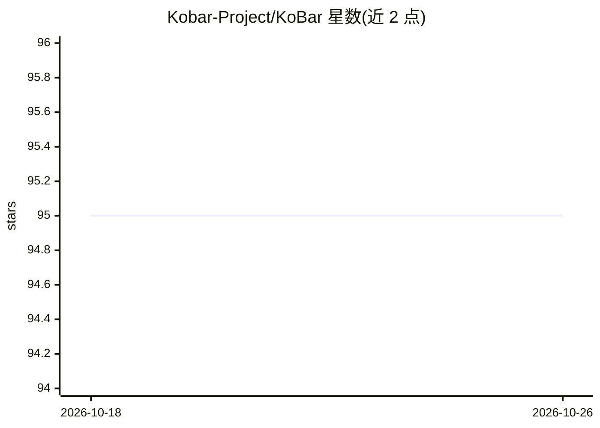

# Kobar-Project/KoBar

⭐ 95 · TypeScript · MIT · 推送 2026-10-24 · [GitHub](https://github.com/Kobar-Project/KoBar) · [官网](https://kobar.org) · 个人维护

**桌面常驻侧边栏工具条：笔记+插件化的效率工具集合**

基于 Electron 和 React 的无边框、透明、置顶桌面侧边栏，内置富文本笔记面板，其余功能（剪贴板管理、媒体控制、截图、计算器等 13 个官方插件）通过插件商店按需安装。支持工作区布局切换、备份恢复、10 种语言；插件未沙箱化，非官方来源插件带“未验证”警告。Windows 10/11 经 Microsoft Store 或安装包分发，macOS 为实验性构建；开发者可从源码运行并基于 v1 插件 API（五个全局对象）开发插件。

## 筛选速览

| 维度 | 判定 | 备注 |
|---|---|---|
| AI 角色 | `ai-enhanced` | 去掉 AI 部分产品仍成立 |
| 许可风险 | `permissive` | MIT |
| 部署形态 | `library` | 以包/库形式分发 |
| 模型依赖 | — | README 未给出锁定关系 |
| 硬件要求 | — | 无带数字的原话,不猜 |
| 安装摩擦 | `low` | 无编译、无系统依赖或容器化 |
| 成熟度 | `idea` | |

## 能力要点

- 置顶侧边栏 + 笔记 + 13 个官方插件（含支持多 provider 与本地模型的 AI Hub）
- 工作区保存/切换布局，一键备份导出为单文件
- 插件商店分发，非官方组织插件标记 unverified
- v1 插件 API（5 个全局对象）与面向 coding agent 的开发指南

## 适用场景

- 在屏幕边缘常驻一条笔记和常用小工具
- 只装自己需要的效率插件（剪贴板、截图、计算器等）
- 通过 AI Hub 插件在侧边栏内使用 AI 助手

## 场景标签

`AI 助手` `知识库管理` · 领域:对话与助手

## 证据(README 行号)

> L12: KoBar is a frameless, transparent, always-on-top bar that docks to the edge of your screen. It has a built-in notes
> L44: |AI Hub|AI assistant for several providers, including local models|

## 星数曲线

2026-10-18 95 → 2026-10-26 95（+0）

---
*卡片 v1 · prompt 1.4 · 生成 2026-10-23 · 置信度 high · 依据 README sha `94212635943d` · [字段定义](../../DATASET.md)*
