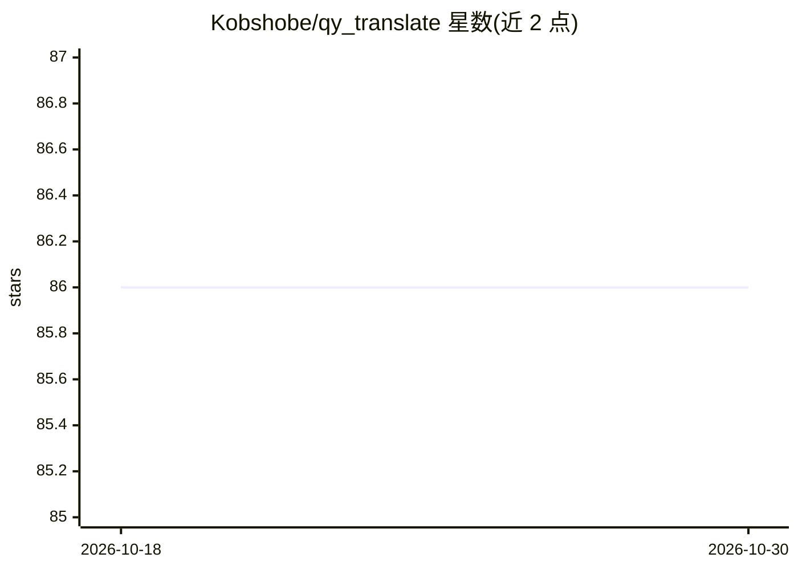

# Kobshobe/qy_translate

⭐ 86 · JavaScript · GPL-3.0 · 推送 2026-08-23 · [GitHub](https://github.com/Kobshobe/qy_translate) · 个人维护 · 中文 README

**Chrome 网页翻译扩展：传统引擎与 AI 大模型翻译**

Chrome 浏览器翻译扩展，基于 Vue 3 与 TypeScript 构建。功能包括网页双语对照翻译、任意网页划词翻译、弹窗或快捷键查词（Alt+K/⌘+K）、PDF 翻译与生词收藏。支持多种传统翻译引擎（百度、Google 等），并支持接入 AI 大模型翻译（DeepSeek、OpenAI、Claude、MiniMax、GLM、Qwen 等），可自定义 API 端点、模型与提示词。安装途径为 Chrome Web Store 与 Edge Add-ons，开发模式经 pnpm 构建后以未打包扩展加载。

## 筛选速览

| 维度 | 判定 | 备注 |
|---|---|---|
| AI 角色 | `ai-enhanced` | 去掉 AI 部分产品仍成立 |
| 许可风险 | `viral` | GPL-3.0 |
| 部署形态 | `library` | 以包/库形式分发 |
| 模型依赖 | — | README 未给出锁定关系 |
| 硬件要求 | — | 无带数字的原话,不猜 |
| 安装摩擦 | `low` | 无编译、无系统依赖或容器化 |
| 成熟度 | — | 结构信号不足 |

## 能力要点

- 网页双语对照翻译与划词翻译
- 支持百度、Google 等多种翻译引擎
- 支持接入 DeepSeek/OpenAI/Claude/MiniMax/GLM/Qwen 等 AI 大模型翻译，可自定义端点、模型与提示词
- PDF 翻译与生词收藏功能

## 适用场景

- 浏览网页时获得双语对照翻译
- 用划词或快捷键快速查词
- 通过自定义 AI 端点与提示词定制翻译效果

## 场景标签

 · 领域:浏览器扩展/翻译工具

## 证据(README 行号)

> L16: - Web page translation with bilingual display
> L20: - AI large model translation (DeepSeek, OpenAI, Claude, MiniMax, GLM, Qwen, etc.) with custom API endpoints, models

## 星数曲线

2026-10-18 86 → 2026-10-30 86（+0）

---
*卡片 v1 · prompt 1.4 · 生成 2026-10-24 · 置信度 high · 依据 README sha `9879252c9135` · [字段定义](../../DATASET.md)*
