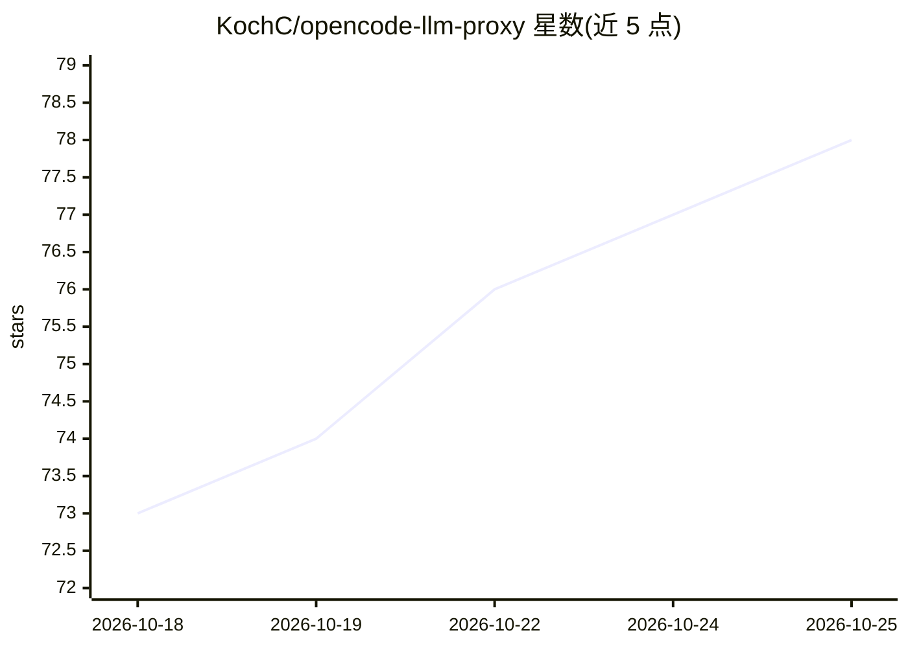

# KochC/opencode-llm-proxy

⭐ 79 · JavaScript · MIT · 推送 2026-10-24 · [GitHub](https://github.com/KochC/opencode-llm-proxy) · [官网](https://www.npmjs.com/package/opencode-llm-proxy) · 个人维护

**给开发者的 OpenCode 插件：本地 LLM 网关，统一转换多种 API 格式**

以 OpenCode 插件形式运行的本地 HTTP 代理（默认 127.0.0.1:4010），把工具发出的 OpenAI Chat Completions / Responses、Anthropic Messages、Gemini 请求翻译到 OpenCode 已配置的任意 LLM 提供方，支持流式输出、工具/函数调用（含并行调用）、多模态输入与结构化 JSON 输出。面向使用各类 SDK、编码 agent、n8n 等工具的开发者，通过 npm 安装并随 OpenCode 启动，非独立服务器；提供 bearer token、限流、Prometheus 指标等配置项。限制：不支持 stop/seed 等部分参数，请求间无状态。

## 筛选速览

| 维度 | 判定 | 备注 |
|---|---|---|
| AI 角色 | `ai-ecosystem` | LLM/agent 周边工具 |
| 许可风险 | `permissive` | MIT |
| 部署形态 | `library` | 以包/库形式分发 |
| 模型依赖 | local-ok | 支持本地模型 |
| 硬件要求 | — | 无带数字的原话,不猜 |
| 安装摩擦 | `low` | 无编译、无系统依赖或容器化 |
| 成熟度 | — | 结构信号不足 |

## 能力要点

- 四种 API 格式互转（OpenAI 两种/Anthropic/Gemini），均含流式与工具调用
- 并行工具调用在单次响应中返回多个完整调用
- 模型别名、回退模型 ID 映射与 LAN 共享模式
- SSRF 安全的远程媒体抓取与请求大小/并发限制配置

## 适用场景

- 让只支持 OpenAI 格式的工具复用 OpenCode 已配置的模型（如 GitHub Copilot 订阅）
- Python 脚本经 OpenAI SDK 直接调用本地 Ollama 模型 ID
- 在局域网向队友共享模型访问，统一 bearer token 鉴权
- 编码 agent（Claude Code、Cursor、Cline 等）经代理获得真实工具调用能力

## 场景标签

`模型网关` · 领域:Agent 开发

## 证据(README 行号)

> L10: opencode-llm-proxy is an OpenCode plugin that starts a local HTTP server on `http://127.0.0.1:4010`. It translates 
> L28: **✨ Tool calling works with all four formats — including parallel tool calls.** Point a coding agent (Claude Code, 
> L99: This package is an OpenCode plugin, not a standalone server. It intentionally has no `npm start` command; load it t

## 星数曲线

2026-10-18 73 → 2026-10-25 78（+5）

---
*卡片 v1 · prompt 1.4 · 生成 2026-10-24 · 置信度 high · 依据 README sha `e3e335aa2e7d` · [字段定义](../../DATASET.md)*
