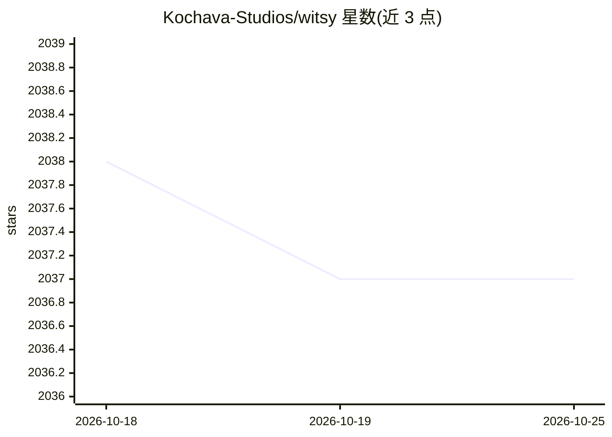

# Kochava-Studios/witsy

⭐ 2,038 · TypeScript · AGPL-3.0 · 推送 2026-04-23 · [GitHub](https://github.com/Kochava-Studios/witsy) · 组织维护

**桌面 AI 助手与通用 MCP 客户端（BYOK 多模型）**

基于 Electron 的桌面 AI 助手应用，采用 BYOK 模式：用户配置各家 LLM 提供商 API key，或用 Ollama 本地运行模型。支持聊天（视觉）、文生图/文生视频、语音转写、TTS、RAG 文档问答等能力，并自称通用 MCP 客户端——可为几乎所有 LLM 运行 MCP 服务器。附带 Prompt Anywhere（任意应用内生成）、AI 命令、本地 HTTP API、CLI 与 Agent Webhook。限制：需自备 API key；语音/图像等部分能力依赖第三方服务。

## 筛选速览

| 维度 | 判定 | 备注 |
|---|---|---|
| AI 角色 | `ai-native` | 本体是模型或模型工具 |
| 许可风险 | `viral` | AGPL-3.0 |
| 部署形态 | `desktop` | 安装包/桌面程序 |
| 模型依赖 | local-ok | 支持本地模型 |
| 硬件要求 | — | 无带数字的原话,不猜 |
| 安装摩擦 | `low` | 无编译、无系统依赖或容器化 |
| 成熟度 | — | 结构信号不足 |

## 能力要点

- 支持十余家 Chat 提供商及任何兼容 OpenAI API 标准的服务
- 通用 MCP 客户端：任意 LLM 搭配 MCP 服务器
- Prompt Anywhere 与 AI 命令可在任意应用内触发
- 本地 HTTP API（端口 8090）、CLI 与 Agent Webhook 供外部集成

## 适用场景

- 在桌面统一使用多家 LLM 的聊天、图像与语音功能
- 为任意模型接入 MCP 服务器与本地文档 RAG
- 通过 HTTP API/Webhook 把 AI 助手嵌入自动化流程

## 场景标签

`AI 助手` `图像生成` `语音合成` `视频生成` · 领域:对话与助手

## 证据(README 行号)

> L16: Witsy is a BYOK (Bring Your Own Keys) AI application: it means you need to have API keys for the LLM providers you 
> L19: It is the first of very few (only?) universal MCP clients: ***Witsy allows you to run MCP servers with virtually an

## 星数曲线

2026-10-18 2,038 → 2026-10-25 2,037（-1）

---
*卡片 v1 · prompt 1.4 · 生成 2026-10-21 · 置信度 high · 依据 README sha `fb0b4ebf6553` · [字段定义](../../DATASET.md)*
