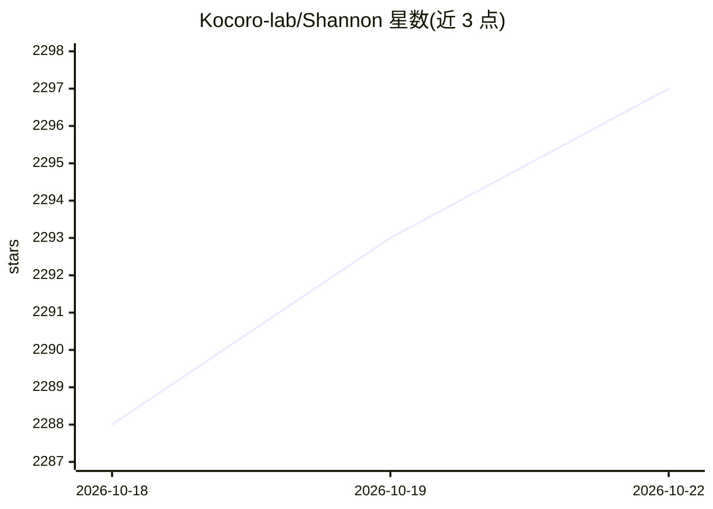

# Kocoro-lab/Shannon

⭐ 2,297 · Go · MIT · 推送 2026-09-05 · [GitHub](https://github.com/Kocoro-lab/Shannon) · [官网](https://shannon.run) · 组织维护 · 中文 README

**面向生产部署的多 Agent 编排框架，内置预算控制与工作流回放**

用 Go、Rust、Python 构建的多 Agent 编排框架，由 Gateway、Orchestrator（Temporal 工作流）、Agent Core（WASI 沙箱）、LLM Service 等服务组成。按任务复杂度自动路由到 8 种执行策略（Simple/DAG/ReAct/Research/Swarm 等），支持 10+ LLM 提供商及 Ollama/vLLM 本地端点、按任务的 token 预算与自动模型回退、人工审批门、时间旅行调试回放。通过一键脚本或 Docker Compose 部署，提供 REST、OpenAI 兼容 API、Python SDK 与桌面应用。运行需 Docker 与至少一个 LLM API key。

## 筛选速览

| 维度 | 判定 | 备注 |
|---|---|---|
| AI 角色 | `ai-ecosystem` | LLM/agent 周边工具 |
| 许可风险 | `permissive` | MIT |
| 部署形态 | `self-host` | docker 或自建部署 |
| 模型依赖 | local-ok | 支持本地模型 |
| 硬件要求 | — | 无带数字的原话,不猜 |
| 安装摩擦 | `low` | 无编译、无系统依赖或容器化 |
| 成熟度 | — | 结构信号不足 |

## 能力要点

- 按复杂度自动路由的 8 种执行策略（DAG/ReAct/Research/Swarm 等）
- Temporal 工作流与时间旅行调试，支持逐步回放执行
- 硬性 token 预算控制与跨提供商自动故障转移
- WASI 沙箱代码执行、OPA 策略与人工审批工作流

## 适用场景

- 在生产环境运行带预算控制与审批门的多 Agent 任务
- 通过 OpenAI 兼容 API 让现有应用接入编排能力
- 研究类任务使用分层模型与 Swarm 多 Agent 协作
- 故障后回放工作流逐步定位 Agent 执行问题

## 场景标签

`多智能体` `Agent 框架` · 领域:Agent 开发

## 证据(README 行号)

> L10: Ship reliable AI agents to production. Multi-strategy orchestration, swarm collaboration, token budget control, hum
> L109: Client --> Gateway (Go) --> Orchestrator (Go) --> Agent Core (Rust) --> LLM Service (Python) --> Providers
> L122: |**LLM Service**|Python|8000|Provider abstraction, MCP tools, agent loop|

## 星数曲线

2026-10-18 2,288 → 2026-10-22 2,297（+9）

---
*卡片 v1 · prompt 1.4 · 生成 2026-10-21 · 置信度 mid · 依据 README sha `8f690d392838` · [字段定义](../../DATASET.md)*
