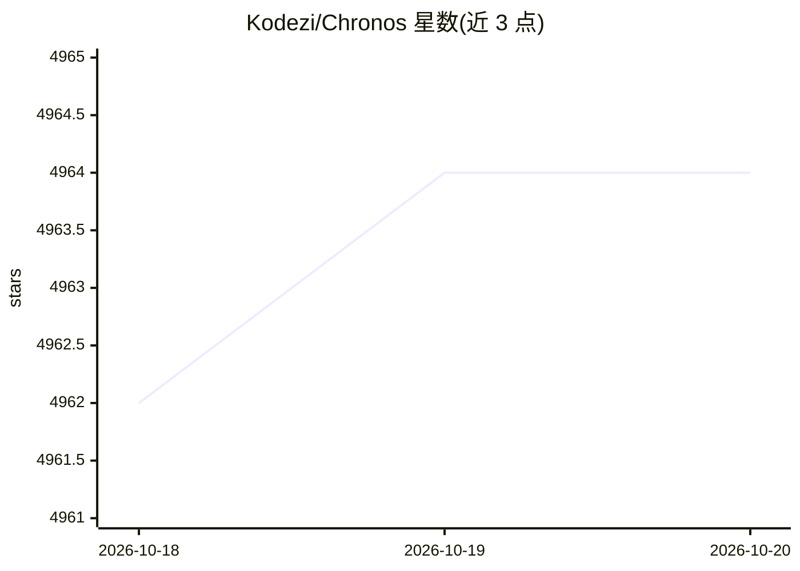

# Kodezi/Chronos

⭐ 4,964 · Java · NOASSERTION · 推送 2025-11-12 · [GitHub](https://github.com/Kodezi/Chronos) · [官网](https://chronos.so/) · 组织维护

**调试优先语言模型的研究与基准仓库，模型本体未开源**

Kodezi Chronos 是定位为调试优先的语言模型，宣称在 SWE-bench Lite 达到 80.33%。本仓库仅包含研究论文（arXiv:2507.12482）、基准套件、评估结果与算法参考实现；模型为专有资产，不在仓库内，需通过 Kodezi OS 获取（2025 Q4 企业 Beta，2026 Q1 正式发布）。架构描述包括自适应图引导检索（AGR）、持久化调试记忆（PDM）与七层系统设计，训练数据为 42.5M 调试示例。仓库提供 git clone 后运行基准测试的流程，要求 Python 3.8+。

## 筛选速览

| 维度 | 判定 | 备注 |
|---|---|---|
| AI 角色 | `ai-knowledge` | 知识聚合/清单类 |
| 许可风险 | `none` | NOASSERTION |
| 部署形态 | `None` |  |
| 模型依赖 | — | README 未给出锁定关系 |
| 硬件要求 | — | 无带数字的原话,不猜 |
| 安装摩擦 | `low` | 无编译、无系统依赖或容器化 |
| 成熟度 | — | 结构信号不足 |

## 能力要点

- 仓库含研究论文、基准套件与 SWE-bench Lite 评估结果（80.33%）
- 模型为专有，仅通过 Kodezi OS 于 2026 Q1 提供访问
- 自述架构：AGR 图检索、PDM 跨会话调试记忆、七层系统设计
- 自述训练数据为 42.5M 调试工作流示例（非代码补全）

## 适用场景

- 查阅调试专用语言模型的研究论文与方法论
- 复现 SWE-bench Lite 与 MRR 基准评估流程
- 了解仓库级代码调试的基准数据集（500 样本已发布）

## 场景标签

`模型评测` · 领域:评测与运维

## 证据(README 行号)

> L31: **Chronos is proprietary and available exclusively through Kodezi OS**
> L38: **This repository contains research paper, benchmarks, and evaluation results only.**

## 星数曲线

2026-10-18 4,962 → 2026-10-20 4,964（+2）

---
*卡片 v1 · prompt 1.4 · 生成 2026-10-20 · 置信度 high · 依据 README sha `3881fa9681b4` · [字段定义](../../DATASET.md)*
