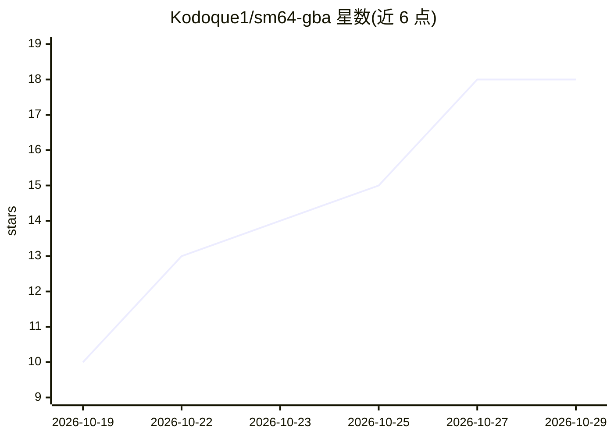

# Kodoque1/sm64-gba

⭐ 18 · C · NOASSERTION · 推送 2026-10-18 · [GitHub](https://github.com/Kodoque1/sm64-gba) · 个人维护

**SM64 移动与碰撞代码的 GBA 移植，逐位一致，附可玩 demo**

将《超级马里奥 64》的移动、碰撞与动画代码移植到 Game Boy Advance（16.78 MHz ARM7、无 FPU），以未经修改的 decomp 代码为逐位一致性基准，经两轮优化后平均提速 4.9 倍且仍逐位精确。包含软件 3D 渲染的可玩 demo（4 个关卡、30 fps），可从用户自有 ROM 导入马里奥真实模型与关卡网格。代码、测试与工程笔记由 Claude Opus 5.5 编写，作者将其定位为 LLM 能力基准。通过 Docker 或本地工具链 make 构建生成 .gba ROM，仅在模拟器中验证，未在真机 GBA 测试。

## 筛选速览

| 维度 | 判定 | 备注 |
|---|---|---|
| AI 角色 | `ai-ecosystem` | LLM/agent 周边工具 |
| 许可风险 | `none` | NOASSERTION |
| 部署形态 | `self-host` | docker 或自建部署 |
| 模型依赖 | — | README 未给出锁定关系 |
| 硬件要求 | — | 无带数字的原话,不猜 |
| 安装摩擦 | `low` | 无编译、无系统依赖或容器化 |
| 成熟度 | — | 结构信号不足 |

## 能力要点

- 马里奥全状态逐帧与未修改 decomp 基准逐位比对
- 两轮定点优化后平均 4.9 倍提速且保持逐位一致
- 可玩 demo：4 关卡、软件 3D 渲染、99% 帧达 30 fps（mGBA）
- 支持从用户自有 ROM 导入马里奥模型与关卡网格

## 适用场景

- 在 GBA 模拟器或烧录卡上体验 SM64 物理的可玩 demo
- 研究定点数优化与软件 3D 渲染在无 FPU 平台的实现
- 作为 LLM 生成嵌入式代码能力的可验证基准案例

## 场景标签

 · 领域:游戏/嵌入式开发

## 证据(README 行号)

> L17: **Built with Claude Opus 5.5.** The code, the test harness and the
> L18: engineering notes in this README were written by Claude Opus 5.5
> L26: possible to the original would be a fun benchmark for an LLM, because it

## 星数曲线

2026-10-19 10 → 2026-10-29 18（+8）

---
*卡片 v1 · prompt 1.4 · 生成 2026-10-29 · 置信度 mid · 依据 README sha `e0bdd819bc20` · [字段定义](../../DATASET.md)*
