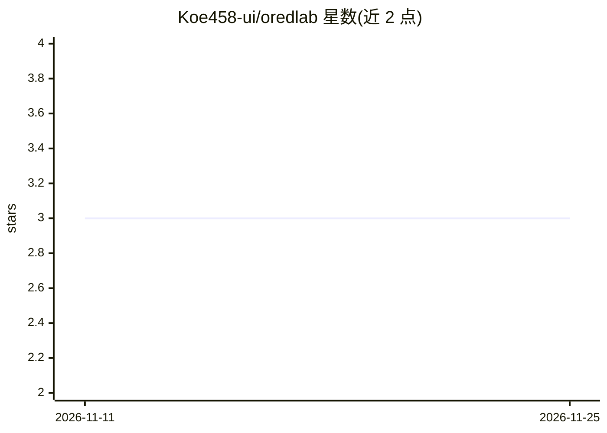

# Koe458-ui/oredlab

⭐ 3 · Python · Apache-2.0 · 推送 2026-11-23 · [GitHub](https://github.com/Koe458-ui/oredlab) · [官网](https://oredlab.com) · 个人维护

**从零训练、可下载本地运行的 AI 模型项目**

oredlab 是一个从零训练的开源 AI 模型项目，目标是让用户下载模型权重后在自己的 PC 上运行推理，不依赖云端 AI 服务、无需账号或 API key。项目早期阶段：1M/10M 参数原型已可下载，50M 与 250M 正在训练，首个公开 checkpoint 尚在计划中；本地推理、多平台安装指南与打包桌面应用均列为路线图的 Planned 项。仓库以 Apache-2.0 许可发布，网站托管于 Cloudflare Workers。

## 筛选速览

| 维度 | 判定 | 备注 |
|---|---|---|
| AI 角色 | `ai-native` | 本体是模型或模型工具 |
| 许可风险 | `permissive` | Apache-2.0 |
| 部署形态 | `None` |  |
| 模型依赖 | — | README 未给出锁定关系 |
| 硬件要求 | — | 无带数字的原话,不猜 |
| 安装摩擦 | `low` | 无编译、无系统依赖或容器化 |
| 成熟度 | `idea` | |

## 能力要点

- 模型权重按参数规模提供下载（1M/10M 已完成，更大规模在训）
- 定位为本地推理，prompts 保留在本机、无需 API key
- 仓库 Apache-2.0 许可，公开路线图显示整体进度约 29%

## 适用场景

- 下载小型模型权重在自己电脑上离线运行
- 关注该模型训练 checkpoint 的发布进展
- 按公开路线图参与贡献开发

## 场景标签

`模型训练` · 领域:训练与推理

## 证据(README 行号)

> L17:  oredlab is an independent AI model built from the ground up, designed to be accessible, downloadable, and free to 
> L43:  💻 Local inference
> L84:  First public checkpoint

## 星数曲线

2026-11-11 3 → 2026-11-25 3（+0）

---
*卡片 v1 · prompt 1.4 · 生成 2026-11-22 · 置信度 mid · 依据 README sha `a9c472338958` · [字段定义](../../DATASET.md)*
