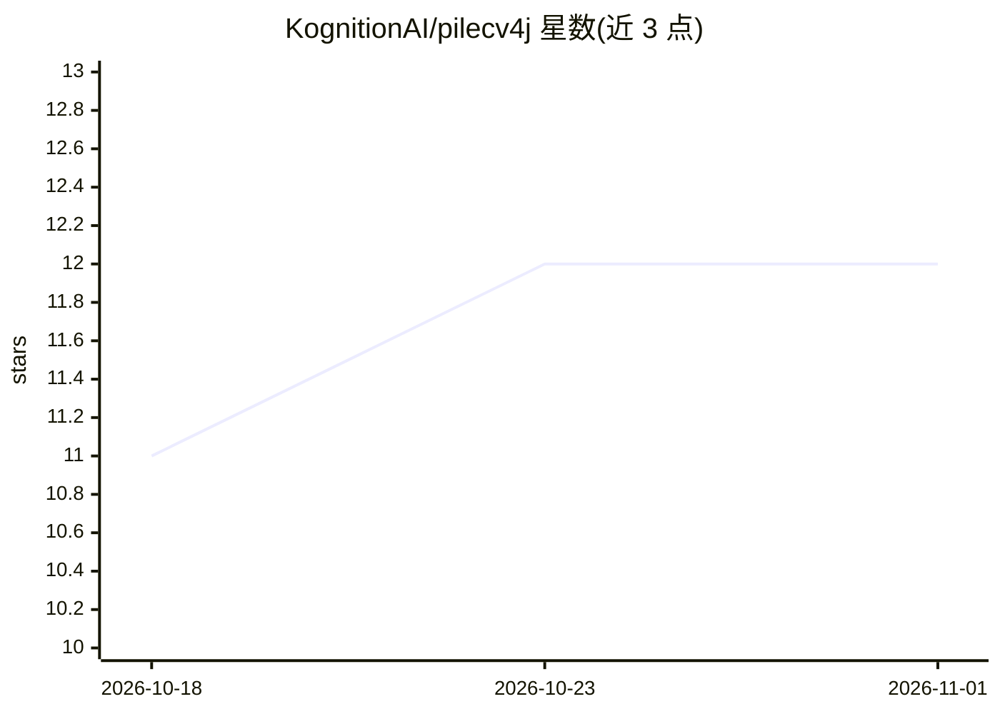

# KognitionAI/pilecv4j

⭐ 12 · Java · Apache-2.0 · 推送 2026-10-29 · [GitHub](https://github.com/KognitionAI/pilecv4j) · 组织维护

**Java 图像视频处理库：整合 FFMpeg/OpenCV/Python/TensorFlow**

面向 Java 开发者的多媒体处理库，分八个模块：lib-image 将 OpenCV Mat 封装为 AutoCloseable 以管理堆外内存；lib-ffmpeg 支持流/文件视频的解码、转封装与编码；lib-python 允许从 Java 调用 PyTorch 等 Python 深度学习框架；lib-tf 提供 TensorFlow 轻量封装；另有共享内存 IPC、Powell 优化、视频目标跟踪等模块。依赖 FFMpeg 与 Python3 开发库，OpenCV 以 jar 预打包自动获取，支持 Linux/Windows/aarch64 平台。

## 筛选速览

| 维度 | 判定 | 备注 |
|---|---|---|
| AI 角色 | `ai-ecosystem` | LLM/agent 周边工具 |
| 许可风险 | `permissive` | Apache-2.0 |
| 部署形态 | `None` |  |
| 模型依赖 | — | README 未给出锁定关系 |
| 硬件要求 | — | 无带数字的原话,不猜 |
| 安装摩擦 | `high` | 编译与系统依赖俱全 |
| 成熟度 | — | 结构信号不足 |

## 能力要点

- OpenCV Mat 封装为 AutoCloseable，解决视频处理时堆外内存问题
- FFmpeg 模块支持流与文件视频的解码、Remux 与编码
- 从 Java 调用 Python 深度学习框架（如 PyTorch）
- 三种实现的跨进程 Mat 共享内存 IPC

## 适用场景

- 用 Java 构建读取 RTSP 流或摄像头并逐帧处理的应用
- 在 Java 工程中复用 Python 深度学习框架与 TensorFlow 模型
- 跨进程传递图像数据的多进程视频处理管线

## 场景标签

`图像视频处理` · 领域:感知与多模态

## 证据(README 行号)

> L3: This project contains several tools for creating image and video processing applications in Java. It combines FFMpeg
> L85: Because many deep learning systems use Python (e.g. PyTorch), lib-python allows you to use these frameworks from yo
> L97: `lib-tf` is a small and lightweight simple wrapper for Google's Tensorflow that ties it into the remaining librarie

## 星数曲线

2026-10-18 11 → 2026-11-01 12（+1）

---
*卡片 v1 · prompt 1.4 · 生成 2026-11-01 · 置信度 mid · 依据 README sha `b89fe37192f6` · [字段定义](../../DATASET.md)*
