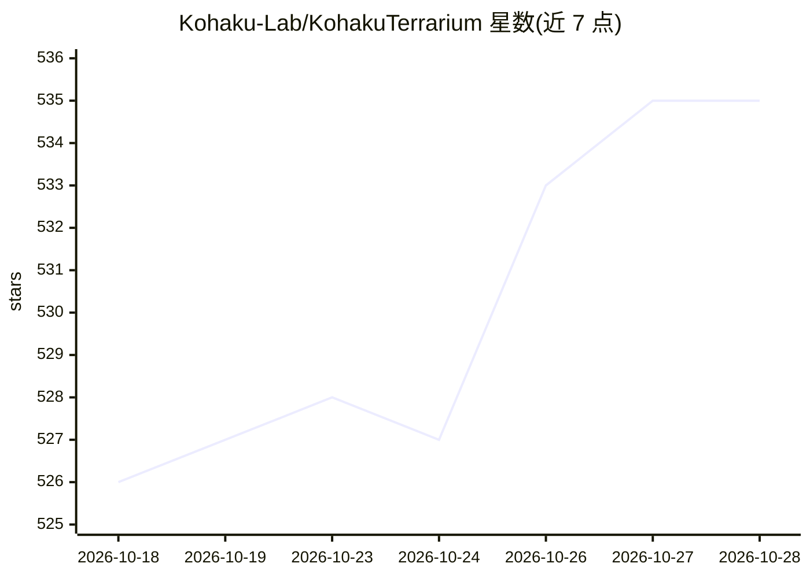

# Kohaku-Lab/KohakuTerrarium

⭐ 536 · Python · NOASSERTION · 推送 2026-10-28 · [GitHub](https://github.com/Kohaku-Lab/KohakuTerrarium) · [官网](https://terrarium.kohaku-lab.org/) · 组织维护 · 中文 README

**Python 通用 AI agent 框架：构建与编排单体/多智能体**

KohakuTerrarium 是用 Python 编写的 agent 框架与配套应用：以 creature（六模块：controller/input/output/tools/triggers/sub-agents）为核心抽象，由 Terrarium 图运行时托管多个 creature 并通过 channel 组成团队，上层 Studio 提供目录、会话持久化与 web/桌面/API 管理界面，可选 Laboratory 层实现跨机部署。内置会话持久化与恢复、可搜索会话历史、后台上下文压缩、MCP 支持、包市场与组合算子。面向需要自定义 agent 形态或从 Python 驱动 agent 的开发者；通过 pip 安装，接入 Codex OAuth、Anthropic、OpenRouter、Gemini、Kimi 等模型来源；要求 Python 3.10+（推荐 3.12+）。

## 筛选速览

| 维度 | 判定 | 备注 |
|---|---|---|
| AI 角色 | `ai-ecosystem` | LLM/agent 周边工具 |
| 许可风险 | `none` | NOASSERTION |
| 部署形态 | `self-host` | docker 或自建部署 |
| 模型依赖 | locked-api |  |
| 硬件要求 | — | 无带数字的原话,不猜 |
| 安装摩擦 | `low` | 无编译、无系统依赖或容器化 |
| 成熟度 | — | 结构信号不足 |

## 能力要点

- 六模块 creature 模型，五个模块可在配置或 Python 中替换实现
- 内置会话持久化/恢复、可搜索历史索引与非阻塞上下文压缩
- MCP 支持（stdio/streamable-HTTP）与组合算子（>>、&、|、*、.iterate）
- CLI/TUI/web 仪表盘/桌面应用多种运行界面，可选 Docker/systemd 部署

## 适用场景

- 构建自定义形态的 agent 而不重写运行时基础设施
- 用 Python 把 agent 嵌入批处理任务、机器人或流水线
- 通过 channel 与特权节点编排多 agent 团队协作

## 场景标签

`Agent 框架` `多智能体` · 领域:Agent 开发

## 证据(README 行号)

> L45: KohakuTerrarium is a framework for building agents, not another agent.
> L80: - **Agent-level abstraction.** The six-module creature model is the first-class concept. A new agent shape is "writ
> L124: Supports Codex OAuth, OpenRouter/OpenAI, native Anthropic, Google Gemini, Kimi Code, GLM Coding Plan, and any Open

## 星数曲线

2026-10-18 526 → 2026-10-28 535（+9）

---
*卡片 v1 · prompt 1.4 · 生成 2026-10-22 · 置信度 high · 依据 README sha `0df1250501f0` · [字段定义](../../DATASET.md)*
