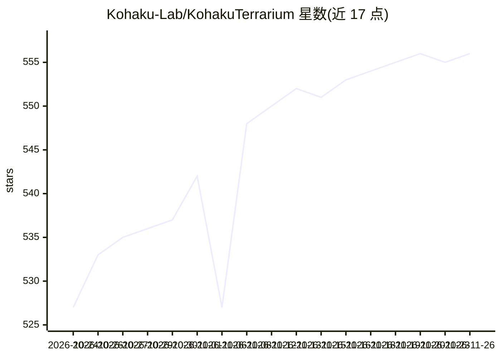

# Kohaku-Lab/KohakuTerrarium

⭐ 556 · Python · NOASSERTION · 推送 2026-11-25 · [GitHub](https://github.com/Kohaku-Lab/KohakuTerrarium) · [官网](https://terrarium.kohaku-lab.org/) · 组织维护 · 中文 README

**构建与组合自包含 agent 和多 agent 团队的 Python 框架**

通用 agent 框架与一体化应用：以 creature（自带控制器、工具、触发器、子 agent、记忆与 I/O 的独立 agent）为核心抽象，由 Terrarium 图运行时托管多 agent 组合，Studio 层提供目录、会话持久化与 web/桌面/API 管理面，可选 Laboratory 层跨机部署。提供 CLI、TUI、web 仪表盘与桌面应用四种运行面，支持 MCP 服务器接入、包系统与市场、组合算子与可搜索的会话历史。面向需要自定义 agent 形态或从 Python 驱动 agent 的开发者。

## 筛选速览

| 维度 | 判定 | 备注 |
|---|---|---|
| AI 角色 | `ai-ecosystem` | LLM/agent 周边工具 |
| 许可风险 | `none` | NOASSERTION |
| 部署形态 | `self-host` | docker 或自建部署 |
| 模型依赖 | local-ok | 支持本地模型 |
| 硬件要求 | — | 无带数字的原话,不猜 |
| 安装摩擦 | `low` | 无编译、无系统依赖或容器化 |
| 成熟度 | — | 结构信号不足 |

## 能力要点

- creature 六模块模型：input/output/tool/trigger/sub-agent + controller 推理循环
- 会话持久化与恢复：kt resume 离线回放 SessionReader，事件可索引搜索
- MCP 支持（stdio/streamable-HTTP）与包系统 + 市场（kt install）
- 组合算子（>>、&、|、*）与 CLI/TUI/web/桌面多运行面

## 适用场景

- 不想从零重写控制器循环、工具分发等底层机制的 agent 开发
- 用 Python 把 agent 嵌入批处理任务、机器人或流水线
- 组合多 agent 团队并通过通道实现横向协作
- 通过 Docker 或 systemd 部署 agent 服务

## 场景标签

`Agent 框架` `多智能体` · 领域:Agent 开发

## 证据(README 行号)

> L45: KohakuTerrarium is a framework for building agents, not another agent.
> L51: The core abstraction is the **creature**: a standalone agent with its own controller, tools, sub-agents, triggers, 
> L62: |**Agent**|***kt-biome***, Claude Code, Codex, OpenCode, OpenClaw, Hermes Agent…|***KohakuTerrarium***, smolagents|

## 星数曲线

2026-10-24 527 → 2026-11-26 556（+29）

---
*卡片 v1 · prompt 1.4 · 生成 2026-11-25 · 置信度 high · 依据 README sha `15a2015a4f8e` · [字段定义](../../DATASET.md)*
