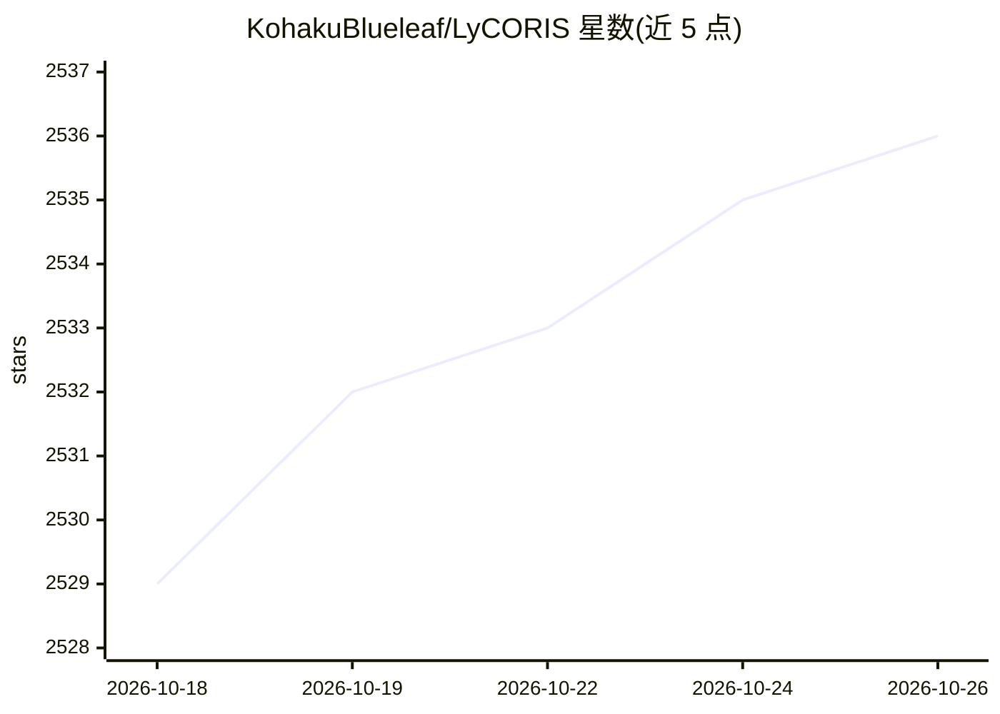

# KohakuBlueleaf/LyCORIS

⭐ 2,536 · Python · Apache-2.0 · 推送 2026-10-19 · [GitHub](https://github.com/KohakuBlueleaf/LyCORIS) · 个人维护

**Stable Diffusion 参数高效微调算法库（LoRA/LoHa/LoKr 等）**

ICLR'24 论文配套的 Python 库，为 Stable Diffusion 及任意 PyTorch 模块实现多种参数高效微调算法：LoRA(LoCon)、LoHa、LoKr、(IA)^3、DyLoRA、Native fine-tuning 等。训练可通过 kohya sd-scripts、Naifu-Diffusion 或作为独立 wrapper 接入自有脚本；生成的模型可在 sd-webui（1.5.0 后内置支持）、ComfyUI、InvokeAI 等界面加载。附带 extract/merge/格式转换工具与实验性 Triton/TileLang 融合内核。注意：HCP-Diffusion 支持已在 3.0.0 移除，融合内核处于早期实验阶段。

## 筛选速览

| 维度 | 判定 | 备注 |
|---|---|---|
| AI 角色 | `ai-ecosystem` | LLM/agent 周边工具 |
| 许可风险 | `permissive` | Apache-2.0 |
| 部署形态 | `library` | 以包/库形式分发 |
| 模型依赖 | — | README 未给出锁定关系 |
| 硬件要求 | — | 无带数字的原话,不猜 |
| 安装摩擦 | `low` | 无编译、无系统依赖或容器化 |
| 成熟度 | `idea` | |

## 能力要点

- 实现 LoRA/LoHa/LoKr/(IA)^3/DyLoRA/Native fine-tuning 等多种 PEFT 算法
- 可作为独立 wrapper 附加到任意 PyTorch 模块，支持多层适配器堆叠与单独恢复
- sd-webui 1.5.0+ 内置 LoRA 系统官方支持 LyCORIS 模型
- 提供 extract_locon、merge、HCP/sd-webui 格式转换等工具脚本

## 适用场景

- 用 LoHa/LoKr 等算法微调 Stable Diffusion 模型生成风格化图片
- 在自有训练脚本中以 wrapper 形式为 PyTorch 模块挂载低秩适配器
- 将多个 LyCORIS 模型合并回底模或转换格式以在 sd-webui 使用

## 场景标签

`微调` · 领域:训练与推理

## 证据(README 行号)

> L12: A project that implements different parameter-efficient fine-tuning algorithms for Stable Diffusion.
> L80: - With your own script by using LyCORIS as standalone wrappers for **ANY** pytorch modules.
> L160: You can check my HakuPhi project to see how I utilize LyCORIS to finetune the Phi-1.5 models.

## 星数曲线

2026-10-18 2,529 → 2026-10-26 2,536（+7）

---
*卡片 v1 · prompt 1.4 · 生成 2026-10-21 · 置信度 high · 依据 README sha `8c9e55f7b028` · [字段定义](../../DATASET.md)*
