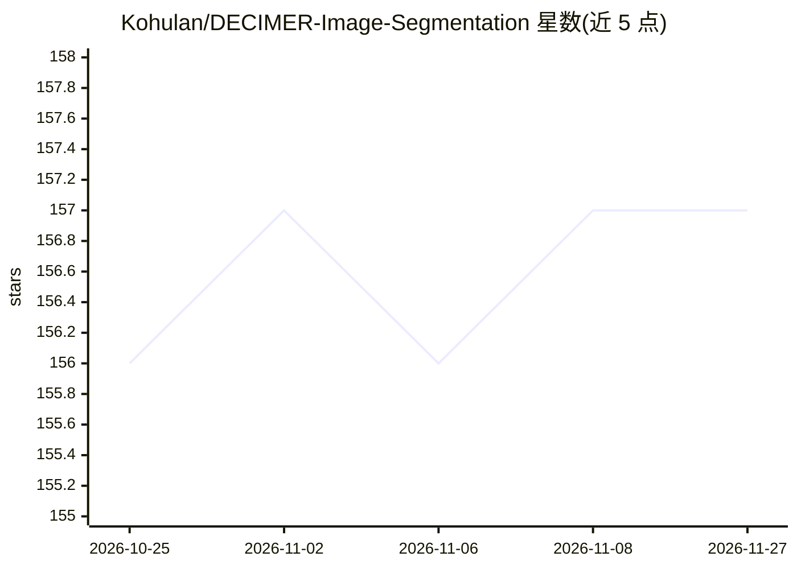

# Kohulan/DECIMER-Image-Segmentation

⭐ 157 · Jupyter Notebook · MIT · 推送 2026-10-25 · [GitHub](https://github.com/Kohulan/DECIMER-Image-Segmentation) · [官网](https://decimer.ai) · 组织维护

**从科学文献中自动检测并分割化学结构图的深度学习工具**

基于 Mask R-CNN 的开源工具，用于从 PDF、扫描页与位图中检测并提取化学结构 depiction：先由模型生成结构掩码，再经后处理扩展掩码以覆盖完整结构。提供 Python API、命令行脚本与 decimer.ai 网页界面；首次使用时自动下载约 270 MB 权重；支持 GPU 加速批处理，CPU 亦可运行。模型权重 DOI 公开，属于 DECIMER 化学结构识别流水线的分割环节。

## 筛选速览

| 维度 | 判定 | 备注 |
|---|---|---|
| AI 角色 | `ai-native` | 本体是模型或模型工具 |
| 许可风险 | `permissive` | MIT |
| 部署形态 | `library` | 以包/库形式分发 |
| 模型依赖 | — | README 未给出锁定关系 |
| 硬件要求 | — | 无带数字的原话,不猜 |
| 安装摩擦 | `medium` | 含编译或系统依赖之一 |
| 成熟度 | — | 结构信号不足 |

## 能力要点

- Mask R-CNN 实例分割检测化学结构，含掩码扩展后处理
- 支持 PDF（pypdfium2/可选 PyMuPDF）、扫描页与位图输入
- 提供 CLI、Python API 与 decimer.ai 网页界面
- 预训练模型约 270 MB，首次使用时自动下载

## 适用场景

- 从期刊论文 PDF 批量提取化学结构图片
- 数字化扫描的历史化学文献页面
- 为 OCSR 流水线（如 DECIMER Image Transformer 转 SMILES）提供输入

## 场景标签

`科研工具` `目标检测` · 领域:学习与行业

## 证据(README 行号)

> L27: > Chemistry has accumulated vast amounts of knowledge about chemical compounds, structures, and properties across c
> L35: DECIMER Segmentation uses advanced deep learning to:
> L36: - 🔍 **Detect** chemical structure depictions in scientific publications

## 星数曲线

2026-10-25 156 → 2026-11-27 157（+1）

---
*卡片 v1 · prompt 1.4 · 生成 2026-11-27 · 置信度 high · 依据 README sha `5537f985d645` · [字段定义](../../DATASET.md)*
