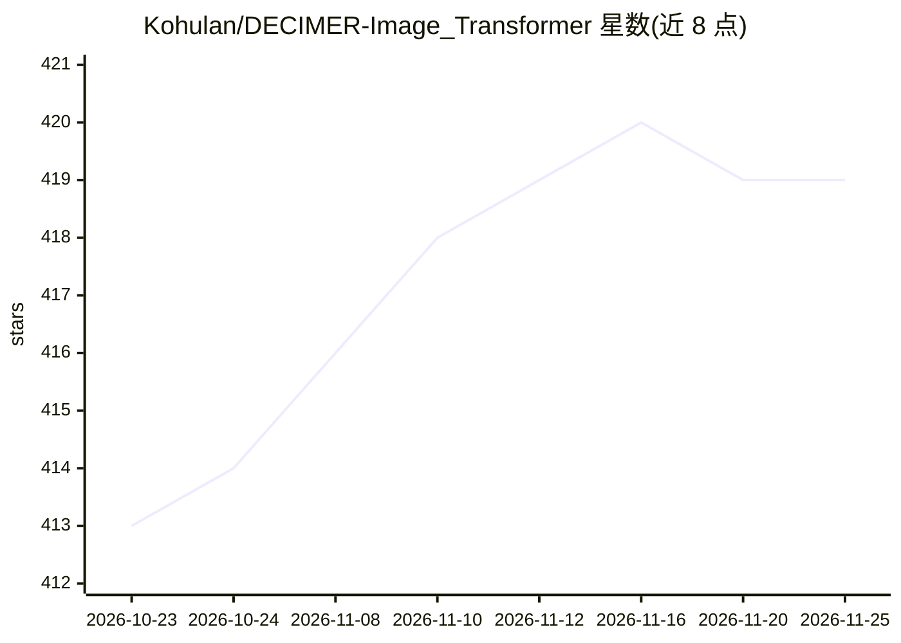

# Kohulan/DECIMER-Image_Transformer

⭐ 419 · Python · MIT · 推送 2026-10-25 · [GitHub](https://github.com/Kohulan/DECIMER-Image_Transformer) · 组织维护

**化学结构图像转 SMILES 的深度学习识别工具**

DECIMER 2.2 是面向 OCSR（光学化学结构识别）任务的开源深度学习工具：用 EfficientNet-V2 提取图像特征，经 transformer 模型将化学结构图像转换为 SMILES 字符串。通过 Python/pip 分发，模型权重不含在包内，首次调用时从 Zenodo 下载并缓存（约 300 MB），预置模型目录后可离线运行。支持印刷与手绘两种结构模型，训练使用 Google TPU。由耶拿大学 Steinbeck 课题组维护，附三篇可引用论文。

## 筛选速览

| 维度 | 判定 | 备注 |
|---|---|---|
| AI 角色 | `ai-native` | 本体是模型或模型工具 |
| 许可风险 | `permissive` | MIT |
| 部署形态 | `library` | 以包/库形式分发 |
| 模型依赖 | — | README 未给出锁定关系 |
| 硬件要求 | — | 无带数字的原话,不猜 |
| 安装摩擦 | `low` | 无编译、无系统依赖或容器化 |
| 成熟度 | — | 结构信号不足 |

## 能力要点

- EfficientNet-V2 + transformer 将化学结构图像转 SMILES
- 支持印刷结构与手绘结构（hand_drawn=True）两种模型
- 模型权重首次调用时从 Zenodo 下载，可预装目录实现离线运行
- 基于 TPU 训练，可处理超百万级图像数据集

## 适用场景

- 从扫描文献或专利中数字化化学结构
- 批量识别论文图片中的分子结构并转为 SMILES
- 识别手绘的化学结构示意图

## 场景标签

`科研工具` `OCR` · 领域:学习与行业

## 证据(README 行号)

> L24: > The DECIMER 2.2 project tackles the OCSR (Optical Chemical Structure Recognition) challenge using cutting-edge co
> L61: SMILES = predict_SMILES(image_path)

## 星数曲线

2026-10-23 413 → 2026-11-25 419（+6）

---
*卡片 v1 · prompt 1.4 · 生成 2026-11-25 · 置信度 high · 依据 README sha `2e931d042c15` · [字段定义](../../DATASET.md)*
