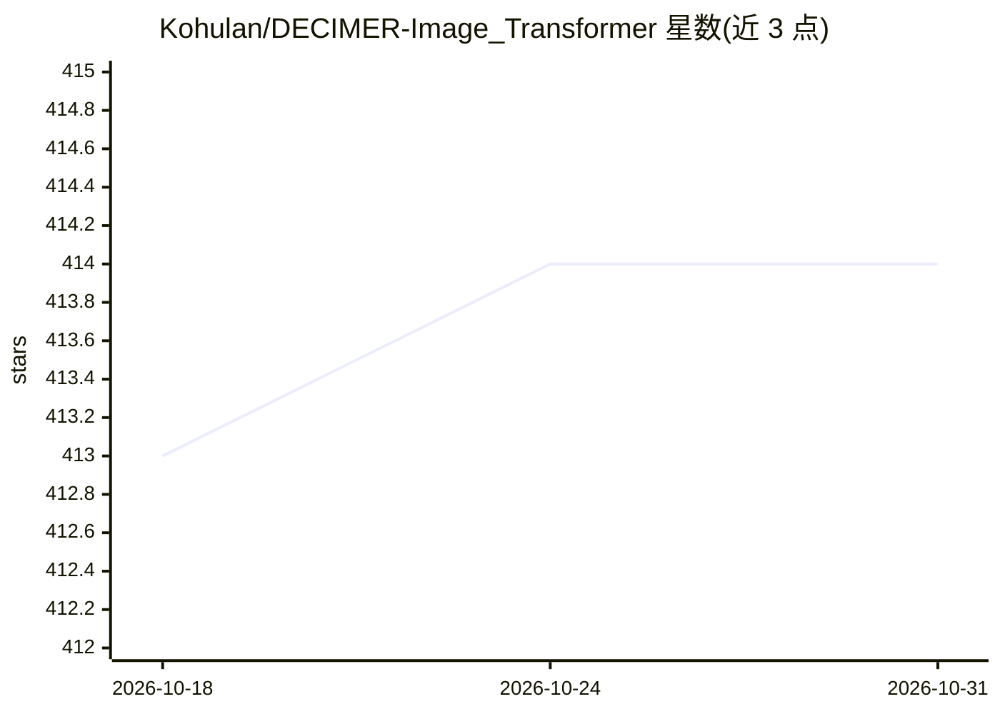

# Kohulan/DECIMER-Image_Transformer

⭐ 414 · Python · MIT · 推送 2026-10-25 · [GitHub](https://github.com/Kohulan/DECIMER-Image_Transformer) · 组织维护

**深度学习 OCSR 工具：把化学结构图像转为 SMILES 字符串**

DECIMER Image Transformer 面向光学化学结构识别（OCSR）任务：使用 EfficientNet-V2 提取图像特征，配合 Transformer 模型预测 SMILES 字符串，将扫描文档、文献中的化学结构图像数字化。训练使用 TFRecord、Google Cloud Buckets、TensorFlow Data Pipeline 与 Google TPU 策略处理超百万图像数据集。以 Python 包形式提供（conda 环境下 pip 安装），提供 predict_SMILES 接口，另有针对手绘化学结构的模型版本。由耶拿大学 Steinbeck 化学信息学组维护，附有 Nat. Commun. 与 J Cheminform 论文。

## 筛选速览

| 维度 | 判定 | 备注 |
|---|---|---|
| AI 角色 | `ai-native` | 本体是模型或模型工具 |
| 许可风险 | `permissive` | MIT |
| 部署形态 | `library` | 以包/库形式分发 |
| 模型依赖 | — | README 未给出锁定关系 |
| 硬件要求 | — | 无带数字的原话,不猜 |
| 安装摩擦 | `low` | 无编译、无系统依赖或容器化 |
| 成熟度 | — | 结构信号不足 |

## 能力要点

- EfficientNet-V2 特征提取 + Transformer 预测 SMILES
- 支持扫描文档与文献中的化学结构图像数字化
- 另提供手绘化学结构识别模型
- 训练管线支持 Google TPU 与超百万图像数据集

## 适用场景

- 从扫描文献或专利中批量提取化学结构为 SMILES
- 把手绘化学结构图转换为机器可读格式
- 化学数据数字化流程中的结构识别环节

## 场景标签

`科研工具` · 领域:学习与行业

## 证据(README 行号)

> L24: > The DECIMER 2.2 project tackles the OCSR (Optical Chemical Structure Recognition) challenge using cutting-edge co
> L31:  Now utilizing EfficientNet-V2 for superior image analysis
> L34:  Employing a state-of-the-art transformer model

## 星数曲线

2026-10-18 413 → 2026-10-31 414（+1）

---
*卡片 v1 · prompt 1.4 · 生成 2026-10-21 · 置信度 high · 依据 README sha `e4699de450bb` · [字段定义](../../DATASET.md)*
