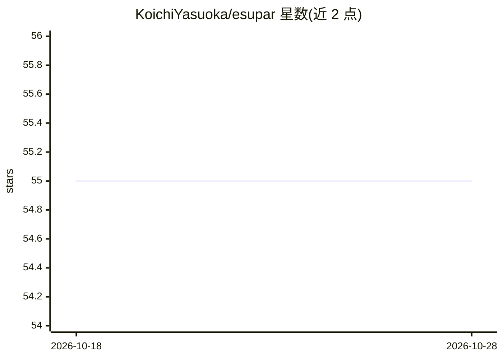

# KoichiYasuoka/esupar

⭐ 55 · Python · MIT · 推送 2026-09-01 · [GitHub](https://github.com/KoichiYasuoka/esupar) · 个人维护

**基于 Transformers 的多语言分词/词性标注/依存句法分析库**

Python NLP 库，基于 Transformers 与 SuPar，提供分词、词性标注与依存句法分析流水线，输出遵循 Universal Dependencies。通过 esupar.load(model) 加载预训练模型，覆盖日语、韩语、中文、文言文、泰语、越南语、英语、德语、塞尔维亚语、科普特语、阿伊努语等 20 余个模型选项。提供 pip 安装，支持 Linux、Cygwin64 与 Google Colaboratory 环境，附可运行 notebook。由个人（安岡孝一）维护。

## 筛选速览

| 维度 | 判定 | 备注 |
|---|---|---|
| AI 角色 | `ai-native` | 本体是模型或模型工具 |
| 许可风险 | `permissive` | MIT |
| 部署形态 | `library` | 以包/库形式分发 |
| 模型依赖 | — | README 未给出锁定关系 |
| 硬件要求 | — | 无带数字的原话,不猜 |
| 安装摩擦 | `low` | 无编译、无系统依赖或容器化 |
| 成熟度 | — | 结构信号不足 |

## 能力要点

- 分词、词性标注、依存句法分析一体化流水线
- 基于 BERT/RoBERTa/DeBERTa/GPT 等 Transformers 模型
- 覆盖日语、中文、文言文、韩语等 20 余个语言模型
- 输出遵循 Universal Dependencies 标准

## 适用场景

- 对日文/中文等多语言文本做词性与依存句法标注
- 处理文言文、阿伊努语、科普特语等低资源语言
- 在 Google Colab 中快速进行句法分析实验

## 场景标签

 · 领域:自然语言处理

## 证据(README 行号)

> L5: Tokenizer, POS-tagger, and dependency-parser with Transformers and SuPar.
> L16: `esupar.load(model)` loads a natural language processor pipeline, working on Universal Dependencies. Available `mod

## 星数曲线

2026-10-18 55 → 2026-10-28 55（+0）

---
*卡片 v1 · prompt 1.4 · 生成 2026-10-24 · 置信度 high · 依据 README sha `d93c4233a141` · [字段定义](../../DATASET.md)*
