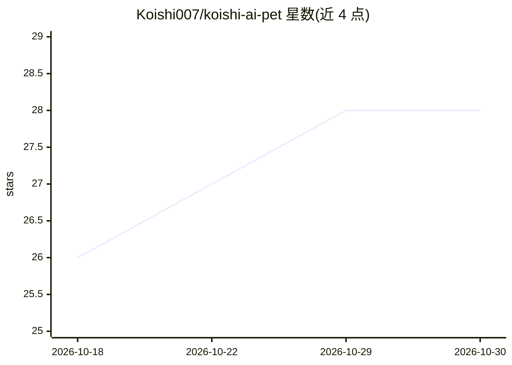

# Koishi007/koishi-ai-pet

⭐ 28 · Python · GPL-3.0 · 推送 2026-10-28 · [GitHub](https://github.com/Koishi007/koishi-ai-pet) · 个人维护 · 中文 README

**东方Project古明地恋形象的桌面 AI 虚拟宠物，能感知屏幕并对话**

基于 PySide6 + LLM 的桌面虚拟宠物应用：通过截图分析实现屏幕视觉感知，支持模拟重力下落、站立窗口顶部、拖拽点击等桌面交互。具备 SQLite 持久记忆（可视化记忆管理）、生理/心理状态参数、5 种互动小游戏、内置浏览器/天气/待办/B站账号等工具系统。LLM 接入提供三种模式：OpenAI 兼容 API、本机 Ollama、离线预设动作模式；支持首选/备选模型自动切换。语音输入需另行配置讯飞 API。

## 筛选速览

| 维度 | 判定 | 备注 |
|---|---|---|
| AI 角色 | `ai-native` | 本体是模型或模型工具 |
| 许可风险 | `viral` | GPL-3.0 |
| 部署形态 | `library` | 以包/库形式分发 |
| 模型依赖 | local-ok | 支持本地模型 |
| 硬件要求 | — | 无带数字的原话,不猜 |
| 安装摩擦 | `low` | 无编译、无系统依赖或容器化 |
| 成熟度 | — | 结构信号不足 |

## 能力要点

- 截图分析 + 窗口探测的屏幕视觉感知，模型驱动自主行动
- SQLite 持久记忆，含可视化记忆管理与语义回忆检索
- OpenAI 兼容 API / 本机 Ollama / 离线三种调用模式，支持备选模型自动切换
- 内置 B 站账号互动、Playwright 浏览器、RAG 知识库等工具，可自行拓展

## 适用场景

- 在桌面养一只可对话、有记忆和状态系统的虚拟宠物
- 让桌宠帮忙查天气、管理待办、浏览网页、刷 B 站
- 和桌宠玩猜拳、井字棋、二十问等小游戏

## 场景标签

`AI 助手` `Agent 记忆` · 领域:Agent 开发

## 证据(README 行号)

> L6: > 基于 PySide6 + LLM 的桌面 AI 虚拟宠物，形象来自东方Project的古明地恋，能感知屏幕、与窗口互动、与用户对话。
> L10: - **自主行动**：通过模型调用控制桌宠行动，有自己的生活节奏，也可以沉默不语；接口报错或超时时自动切换到备选模型
> L11: - **视觉感知**：截图分析 + 窗口探测，理解屏幕上正在发生什么

## 星数曲线

2026-10-18 26 → 2026-10-30 28（+2）

---
*卡片 v1 · prompt 1.4 · 生成 2026-10-26 · 置信度 mid · 依据 README sha `7e520db86209` · [字段定义](../../DATASET.md)*
