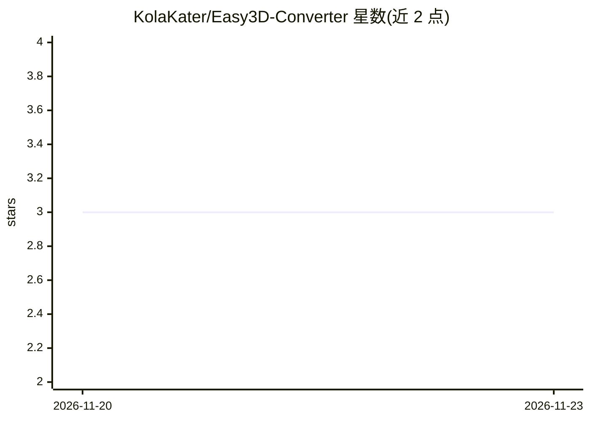

# KolaKater/Easy3D-Converter

⭐ 3 · Python · MIT · 推送 2026-11-22 · [GitHub](https://github.com/KolaKater/Easy3D-Converter) · [官网](https://www.facebook.com/search/top?q=3d%20stereo%20lover) · 个人维护 · 中文 README

**把单张图片/视频转为 SBS 立体 3D 的 GPU 工具**

Easy3D Converter 是一个免费开源的 2D 转 SBS 立体 3D 生成工具，运行在 NVIDIA RTX 3070 及以上的消费级 GPU 上，提供 GUI（通过 .bat 启动）。它不只按深度图平移像素，还会重新生成另一只眼的视图，覆盖光、火、水、雾等无实心表面的元素；支持多种 Fast-Decoupled 模式、两个 Finetuned 模型（v1.5 保守 / v2.1 创意）、Depth Anything 3 与 MoGe 3 深度模型、人脸修复，图片分辨率最高 5120 px，也支持视频（v10+）。

## 筛选速览

| 维度 | 判定 | 备注 |
|---|---|---|
| AI 角色 | `ai-native` | 本体是模型或模型工具 |
| 许可风险 | `permissive` | MIT |
| 部署形态 | `None` |  |
| 模型依赖 | — | README 未给出锁定关系 |
| 硬件要求 | `gpu-8g` | |
| 安装摩擦 | `medium` | 含编译或系统依赖之一 |
| 成熟度 | — | 结构信号不足 |

## 能力要点

- 重新生成另一只眼视图，处理光/火/水/雾等透明无表面元素
- 双 Finetuned 模型：v1.5 保真、v2.1 创意，配合 Face Restore
- 支持 Depth Anything 3 与 MoGe 3 深度模型，RTX 3070+ 最高 5120 px
- 提供 Mode（Quality / Fast-Decoupled A-F）速度与质量分级

## 适用场景

- 把单张风景照转成 SBS 立体 3D 图片
- 带人像的照片生成 3D 时用人脸修复避免脸崩
- 把视频转换为立体 3D 观看素材

## 场景标签

`图像生成` `图像视频处理` · 领域:内容生成

## 证据(README 行号)

> L9: **Turn one image into a side-by-side (SBS) stereo 3D image. / 把一张图变成 SBS 立体 3D 图。**
> L11: **Easy3D is a high-quality 2D-to-3D SBS generation tool — not a generic converter. / Easy3D 是一个高质量的 2D-3D SBS 生成工具，
> L15: Easy3D Converter is a free, open-source tool. It runs on a consumer GPU such as an NVIDIA RTX 3070 or higher.

## 星数曲线

2026-11-20 3 → 2026-11-23 3（+0）

---
*卡片 v1 · prompt 1.4 · 生成 2026-11-22 · 置信度 high · 依据 README sha `69c613c17517` · [字段定义](../../DATASET.md)*
