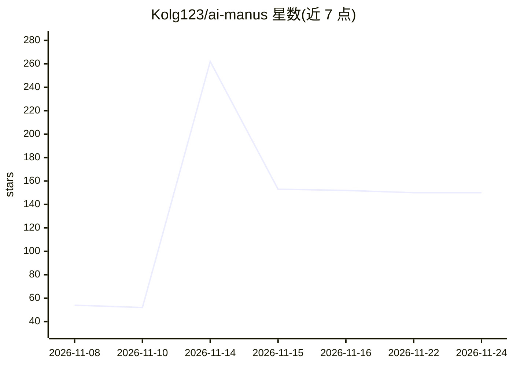

# Kolg123/ai-manus

⭐ 148 · Python · Apache-2.0 · 推送 2026-11-07 · [GitHub](https://github.com/Kolg123/ai-manus) · 个人维护

**自主 AI Agent：代替用户执行代码与控制浏览器完成多步任务**

面向家庭、学习与轻量办公场景的自主 AI Agent：按用户指令自主编写并执行脚本、打开网页并操作页面元素、串联多步任务，可在脚本与浏览器操作间衔接流程。README 将其定位为小型任务助手而非企业平台，适用于整理研究资料、重复表单填写、多页信息收集等场景。README 未给出具体的模型接入方式、安装命令或代码仓库结构说明，仅提供硬件兼容表与使用流程建议。

## 筛选速览

| 维度 | 判定 | 备注 |
|---|---|---|
| AI 角色 | `ai-native` | 本体是模型或模型工具 |
| 许可风险 | `permissive` | Apache-2.0 |
| 部署形态 | `None` |  |
| 模型依赖 | — | README 未给出锁定关系 |
| 硬件要求 | — | 无带数字的原话,不猜 |
| 安装摩擦 | `low` | 无编译、无系统依赖或容器化 |
| 成熟度 | — | 结构信号不足 |

## 能力要点

- 自主编写并执行代码完成任务
- 浏览器控制：导航网页、填表、收集信息
- 脚本与浏览器操作可在同一任务流中衔接
- 定位为小规模家庭/学习/轻办公任务

## 适用场景

- 让 agent 代为收集多网页信息并整理摘要
- 自动填写重复表单与执行小型脚本
- 学习场景中整理研究资料与运行快速计算

## 场景标签

`浏览器自动化` `编码 Agent` · 领域:效率与自动化

## 证据(README 行号)

> L18: Manus is an autonomous AI agent designed to run code and control a browser on your behalf. Instead of acting like a
> L22: Manus is not a heavy studio suite or a complex enterprise platform. It is a focused helper built for home, study, a

## 星数曲线

2026-11-08 54 → 2026-11-24 150（+96）

---
*卡片 v1 · prompt 1.4 · 生成 2026-11-17 · 置信度 mid · 依据 README sha `08b2ce697fe2` · [字段定义](../../DATASET.md)*
