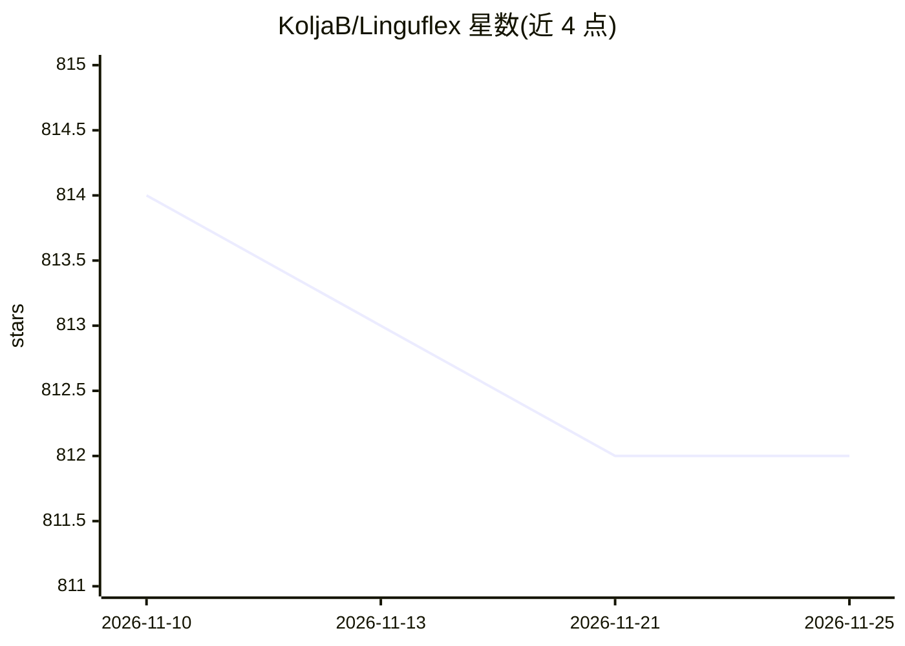

# KoljaB/Linguflex

⭐ 812 · Python · Apache-2.0 · 推送 2026-11-10 · [GitHub](https://github.com/KoljaB/Linguflex) · 个人维护

**Jarvis 式语音 AI 助手框架：本地语音对话与生活功能集成**

面向用户与开发者的 Python 语音 AI 助手框架：通过麦克风语音输入与本地或 OpenAI 语言模型对话，以 TTS（含 XTTS+RVC 语音克隆）输出。功能模块覆盖智能家居（Tuya）、音乐、邮件（IMAP）、天气、日历、搜索等，并支持自定义 AI 角色。Brain 模块可用本地语言模型或 OpenAI GPT API，2.0 新增 Ollama 支持。安装较复杂（多 TTS 引擎、CUDA 等依赖），README 说明暂无 Docker 方案。

## 筛选速览

| 维度 | 判定 | 备注 |
|---|---|---|
| AI 角色 | `ai-native` | 本体是模型或模型工具 |
| 许可风险 | `permissive` | Apache-2.0 |
| 部署形态 | `None` |  |
| 模型依赖 | local-ok | 支持本地模型 |
| 硬件要求 | — | 无带数字的原话,不猜 |
| 安装摩擦 | `medium` | 含编译或系统依赖之一 |
| 成熟度 | — | 结构信号不足 |

## 能力要点

- 本地语音识别、本地 TTS 与本地语言模型推理的完整链路
- Ollama 支持（2.0 新增）
- 模块化扩展：智能家居、邮件、天气、日历、搜索等
- XTTS+RVC 语音克隆与角色切换

## 适用场景

- 通过语音对话控制智能家居、播放音乐、查邮件和天气
- 创建自定义 AI 角色并赋予克隆语音
- 在本地运行以保护隐私的语音 AI 助手

## 场景标签

`语音 Agent` · 领域:对话与助手

## 证据(README 行号)

> L13: It offers voice-based conversation with custom characters, alongside an array of practical features: controlling sm
> L46: - **Brain:** Cognitive Processing Module. Heart of Linguflex, processes user input, either with a local language mo

## 星数曲线

2026-11-10 814 → 2026-11-25 812（-2）

---
*卡片 v1 · prompt 1.4 · 生成 2026-11-17 · 置信度 high · 依据 README sha `867edcbd0b4e` · [字段定义](../../DATASET.md)*
