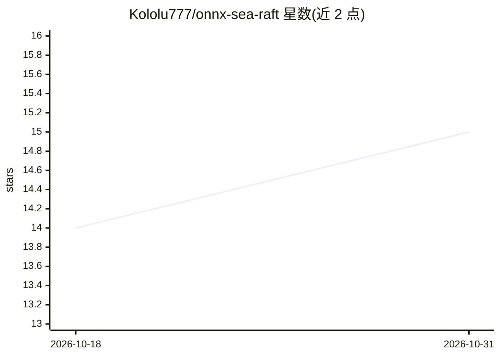

# Kololu777/onnx-sea-raft

⭐ 15 · Python · 推送 2026-01-05 · [GitHub](https://github.com/Kololu777/onnx-sea-raft) · 个人维护

**将 SEA-RAFT 光流模型转为 ONNX 并提供推理示例**

提供官方 PyTorch 版 SEA-RAFT 光流模型到 ONNX 模型的转换脚本（convert/torch_to_onnx.py），并附带使用 ONNX 模型的 demo 代码，输入两张图像输出光流结果。面向需要在 ONNX 运行时中部署光流推断的开发者。环境可经 pip requirements 或 Devcontainer/Docker 镜像建立；转换需以 recursive 方式克隆仓库并下载官方权重；SEA-RAFT 以 BSD 3-Clause 许可发布。

## 筛选速览

| 维度 | 判定 | 备注 |
|---|---|---|
| AI 角色 | `ai-native` | 本体是模型或模型工具 |
| 许可风险 | `none` | — |
| 部署形态 | `library` | 以包/库形式分发 |
| 模型依赖 | — | README 未给出锁定关系 |
| 硬件要求 | — | 无带数字的原话,不猜 |
| 安装摩擦 | `low` | 无编译、无系统依赖或容器化 |
| 成熟度 | — | 结构信号不足 |

## 能力要点

- PyTorch SEA-RAFT → ONNX 转换脚本
- ONNX 模型两帧图像光流推理 demo
- 支持 Devcontainer/Docker 与 pip requirements 两种环境建立方式

## 适用场景

- 把 SEA-RAFT 光流模型转成 ONNX 以便部署
- 用两张图像跑 ONNX 光流推理验证效果

## 场景标签

`图像视频处理` · 领域:感知与多模态

## 证据(README 行号)

> L2: This repo provides a converter for the official pytorch-based SEA-RAFT model to an onnx model along with a demo code
> L25: python3 demo/run.py -m raft.onnx -im1 <image1_path> -im2 <image2_path>

## 星数曲线

2026-10-18 14 → 2026-10-31 15（+1）

---
*卡片 v1 · prompt 1.4 · 生成 2026-10-31 · 置信度 high · 依据 README sha `b9365c77d887` · [字段定义](../../DATASET.md)*
