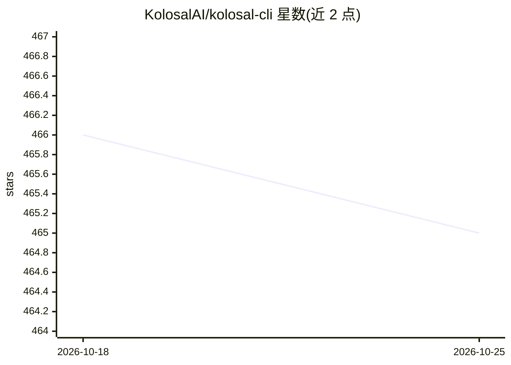

# KolosalAI/kolosal-cli

⭐ 464 · TypeScript · Apache-2.0 · 推送 2025-12-24 · [GitHub](https://github.com/KolosalAI/kolosal-cli) · [官网](https://kolosal.ai) · 组织维护

**面向开发者的命令行 AI 编码工作流工具**

基于 Qwen Code 模型的命令行 AI 工作流工具：支持大规模代码库的查询与编辑、PR 处理与 rebase 等任务自动化、图像多模态分析，并通过 OpenAI 兼容 API 或 Hugging Face 模型接入推理。内置实验性嵌入式 HTTP API（默认 127.0.0.1:38080，支持 SSE 流式与多轮对话）。提供 curl 安装脚本、npm 包、macOS .pkg / Linux .deb 等分发方式，需 Node.js 20 以上；README 注明每轮可能发起多次 API 调用导致 token 用量较高。

## 筛选速览

| 维度 | 判定 | 备注 |
|---|---|---|
| AI 角色 | `ai-native` | 本体是模型或模型工具 |
| 许可风险 | `permissive` | Apache-2.0 |
| 部署形态 | `desktop` | 安装包/桌面程序 |
| 模型依赖 | — | README 未给出锁定关系 |
| 硬件要求 | — | 无带数字的原话,不猜 |
| 安装摩擦 | `low` | 无编译、无系统依赖或容器化 |
| 成熟度 | `idea` | |

## 能力要点

- 跨上下文窗口限制的代码库查询与编辑
- 自动检测图像并切换视觉模型（可配置切换模式）
- 嵌入式本地 HTTP API，支持 SSE 流式与多轮对话
- 提供 macOS .pkg / Linux .deb 等打包分发

## 适用场景

- 在终端里让 AI 分析、重构大型代码库
- 自动化生成变更日志、清理日志语句等任务
- 通过本地 API 把 CLI 能力接入其他程序

## 场景标签

`编码 Agent` · 领域:编码与开发

## 证据(README 行号)

> L7: **AI-powered command-line workflow tool for developers**
> L15: - **Code Understanding & Editing** - Query and edit large codebases beyond traditional context window limits
> L103: #### 1. OpenAI Compatible API

## 星数曲线

2026-10-18 466 → 2026-10-25 465（-1）

---
*卡片 v1 · prompt 1.4 · 生成 2026-10-21 · 置信度 high · 依据 README sha `7b8a40a879e6` · [字段定义](../../DATASET.md)*
