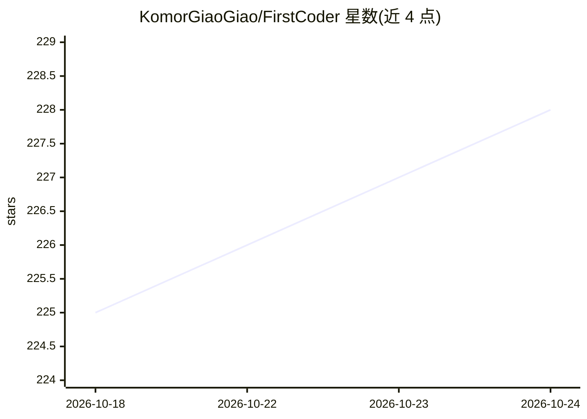

# KomorGiaoGiao/FirstCoder

⭐ 228 · Python · MIT · 推送 2026-10-23 · [GitHub](https://github.com/KomorGiaoGiao/FirstCoder) · [官网](https://komorgiaogiao.github.io/FirstCoder/) · 个人维护 · 中文 README

**本地 Python 编码 Agent：可日常使用且代码可通读**

FirstCoder 是一个本地运行的 Python 编码 Agent，提供 Textual TUI、工具调用、权限确认、会话持久化与上下文压缩（compaction），约 2.5 万行 Python 代码、模块边界清晰，定位于既可日常使用又可端到端阅读学习的实现。Provider 适配以 OpenAI Chat Completions 兼容路径为主，另有 Anthropic Messages API 原生适配器，支持多模型配置、视觉输入暂存与 diff 审查式文件修改。通过 pipx 安装，附 pytest 测试与 Harbor 评测集成。

## 筛选速览

| 维度 | 判定 | 备注 |
|---|---|---|
| AI 角色 | `ai-native` | 本体是模型或模型工具 |
| 许可风险 | `permissive` | MIT |
| 部署形态 | `library` | 以包/库形式分发 |
| 模型依赖 | — | README 未给出锁定关系 |
| 硬件要求 | — | 无带数字的原话,不猜 |
| 安装摩擦 | `low` | 无编译、无系统依赖或容器化 |
| 成熟度 | — | 结构信号不足 |

## 能力要点

- Textual TUI 展示 agent 循环、工具调用、权限提示与流式输出
- 文件修改前生成带红绿标记的统一 diff 审查，可拒绝并反馈
- OpenAI 兼容路径与 Anthropic Messages API 适配器，支持多模型配置切换
- 会话持久化、恢复流程与上下文压缩

## 适用场景

- 本地运行一个编码 Agent 处理日常编程任务
- 研读编码 Agent 的内部机制（agent 循环、工具调用、权限、压缩）
- 在小规模 Python 代码库上做扩展改造或作品集项目

## 场景标签

`编码 Agent` · 领域:编码与开发

## 证据(README 行号)

> L16: FirstCoder is a real, runnable local coding agent with a Textual TUI, tool calling, permissions, sessions, and cont
> L90: - Local Python coding agent

## 星数曲线

2026-10-18 225 → 2026-10-24 228（+3）

---
*卡片 v1 · prompt 1.4 · 生成 2026-10-22 · 置信度 high · 依据 README sha `d9bc21c59f2c` · [字段定义](../../DATASET.md)*
