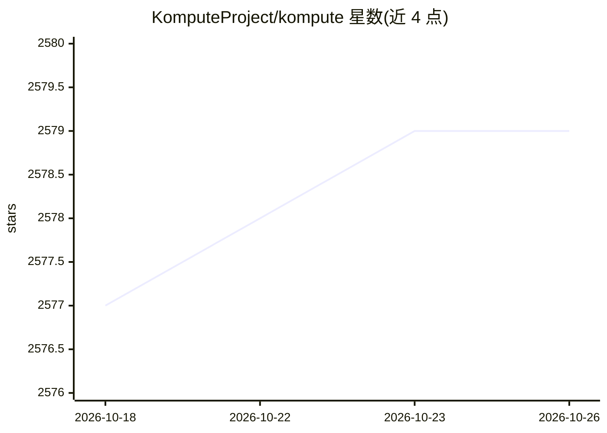

# KomputeProject/kompute

⭐ 2,579 · C++ · Apache-2.0 · 推送 2026-08-15 · [GitHub](https://github.com/KomputeProject/kompute) · [官网](http://kompute.cc/) · 组织维护

**跨厂商 GPU 通用计算框架，基于 Vulkan 加速机器学习与数据处理**

Kompute 是基于 Vulkan 的通用 GPU 计算框架，为 AMD、Qualcomm、NVIDIA 等跨厂商显卡提供 GPU 加速能力，是 LF AI & Data 基金会托管项目。提供 C++ SDK 与 Python 包两种接口：C++ 面向底层优化，Python 支持与 Numpy 数组等对象互操作。架构包含 Manager、Sequence、Operation、Tensor、Algorithm 组件；通过 Vulkan 队列族支持异步与并行执行，支持 Android NDK 移动端环境。Python 包依赖 Python 3.5+ 与 CMake 3.4.1+，通过 pip 安装；C++ 使用 cmake 跨平台构建。GPT4ALL、llama.cpp 等项目使用了 Kompute。

## 筛选速览

| 维度 | 判定 | 备注 |
|---|---|---|
| AI 角色 | `ai-ecosystem` | LLM/agent 周边工具 |
| 许可风险 | `permissive` | Apache-2.0 |
| 部署形态 | `desktop` | 安装包/桌面程序 |
| 模型依赖 | — | README 未给出锁定关系 |
| 硬件要求 | — | 无带数字的原话,不猜 |
| 安装摩擦 | `medium` | 含编译或系统依赖之一 |
| 成熟度 | — | 结构信号不足 |

## 能力要点

- 基于 Vulkan 的跨厂商 GPU 计算框架，支持 AMD/Qualcomm/NVIDIA 等显卡
- C++ SDK 与 Python 包双接口，Python 支持 Numpy 互操作
- 通过 GPU 队列族支持异步与并行操作
- 支持 Android NDK 移动端环境，提供 Godot 游戏引擎 ML 示例

## 适用场景

- 在跨厂商 GPU 上运行机器学习计算（如逻辑回归实现）
- 移动端（Android）设备上的 GPU 加速机器学习
- 游戏引擎内做 GPU 加速的数据处理
- 为 Vulkan 应用嵌入 GPU 计算能力（BYOV 设计）

## 场景标签

 · 领域:GPU 计算/机器学习基础设施

## 证据(README 行号)

> L9:  The general purpose GPU compute framework for cross vendor graphics cards (AMD, Qualcomm, NVIDIA & friends)
> L29: * Flexible Python module with C++ SDK for optimizations
> L246: This project started after seeing that a lot of new and renowned ML & DL projects like Pytorch, Tensorflow, Alibab

## 星数曲线

2026-10-18 2,577 → 2026-10-26 2,579（+2）

---
*卡片 v1 · prompt 1.4 · 生成 2026-10-21 · 置信度 high · 依据 README sha `cc66d03245d2` · [字段定义](../../DATASET.md)*
